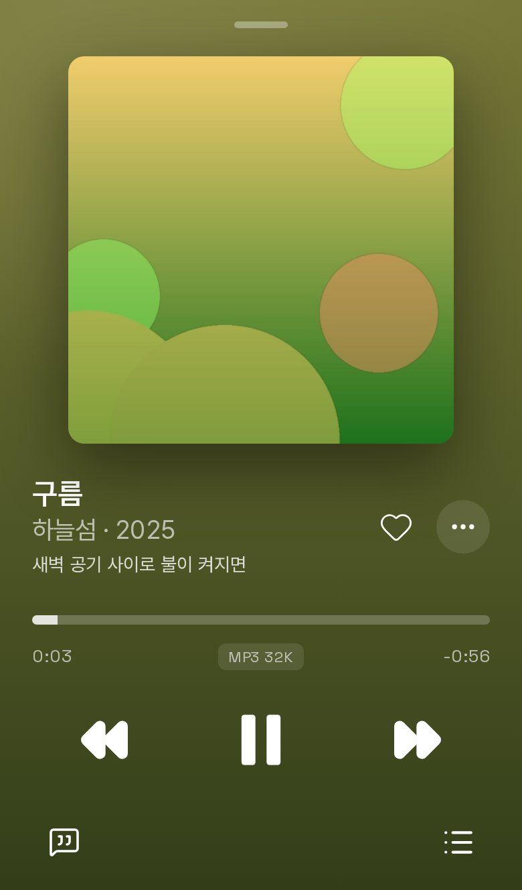

<p align="center">
  
</p>

<h1 align="center">muzplayer</h1>

<p align="center">
  A self-hosted web player for the music, audiobooks and music videos on your NAS — each family member with their own account<br>
  Docker · installable on phones (PWA) · Windows app · Korean / English
</p>

<p align="center">
  <a href="LICENSE"></a>
  <a href="https://hub.docker.com/r/zardkim/muzplayer"></a>
  <a href="https://hub.docker.com/r/zardkim/muzplayer"></a>
</p>

<p align="center"><a href="README.md">🇰🇷 한국어</a> | 🇺🇸 English</p>

---

muzplayer reads your NAS music folder as it is and shows it like a streaming app. Files are never moved or changed; the music folder is mounted read-only.

> The app's interface is available in English; the wiki is written in Korean for now.

## Features

- **Library:** albums, artists, songs, covers, genres and folders; search (Korean initial-consonant search too); albums sorted into regular, unofficial, compilation and soundtrack; Hi-Res and Lossless badges
- **Player:** synced lyrics (.lrc or tags; otherwise looked up through external integrations), an admin lyrics manager, gapless preloading, crossfade, ReplayGain, 10-band EQ, streaming quality, offline downloads
- **For you:** mixes, stations and radio (similar songs keep playing), smart playlists, likes and star ratings, copy or move between playlists
- **Charts & themes:** weekly chart folders and themed collections shown as banners (optional AI banners)
- **Radio:** Korean radio stations relayed live, with a frequency-dial tuner
- **Music videos:** YouTube and NAS video files; extract the audio as m4a/mp3 with tags, cover and lyrics filled in
- **Audiobooks:** chapters, speed, sleep timer, resume on any device, import from Audiobookshelf
- **Multiple users:** per-account history, likes and playlists; sign-up approval; an admin page (scan, backup and restore, statistics)
- **Everywhere:** install on phones (PWA) with lock-screen controls, any desktop browser, the Windows app

## Screenshots

<table>
  <tr>
    <td align="center"></td>
    <td align="center"></td>
    <td align="center"></td>
    <td align="center"></td>
  </tr>
</table>


> Artists, songs, books, covers and lyrics in the screenshots are made up for the demo.

## Install (Docker Compose)

Two containers: `app` (muzplayer) and `db` (PostgreSQL). Nothing to build: the image is
[`zardkim/muzplayer`](https://hub.docker.com/r/zardkim/muzplayer) on Docker Hub (amd64 and arm64).
The examples use `/srv/muzplayer`; on a Synology NAS use something like `/volume1/docker/muzplayer`.

### 1. Make the install folder and get the files

```bash
mkdir -p /srv/muzplayer && cd /srv/muzplayer
curl -fsSLo docker-compose.yml https://raw.githubusercontent.com/zardkim/muzplayer/main/deploy/docker-compose.yml
curl -fsSLo .env.example      https://raw.githubusercontent.com/zardkim/muzplayer/main/deploy/.env.example
cp .env.example .env          # the settings file must be named exactly .env
```

- Docker Compose reads only the `.env` file **next to** `docker-compose.yml`. Left as `.env.example` (or renamed to anything else) it is ignored.
- Files starting with a dot are hidden in most file managers; use `ls -a` to see `.env`.
- Don't edit `docker-compose.yml`: everything you change is in `.env`.

### 2. Settings in `.env`

The four in **bold** must be set.

| Setting | Default | Meaning |
|---|---|---|
| **`MUZPLAYER_DIR`** | `/volume1/docker/muzplayer` | **Absolute** path of the install folder; `app`, `db`, `conf` and `library` are created under it. No relative paths like `./` |
| **`POSTGRES_PASSWORD`** | `change-me-…` | Database password: a long random string (e.g. `openssl rand -hex 24`). **Never change it after the first start** |
| **`PUID`** / **`PGID`** | `1026` / `100` | The user the app runs as; it must be able to **read** your music. `id <user>` → `uid=1026(…) gid=100(users)` means `PUID=1026`, `PGID=100` |
| **`HTTP_PORT`** | `18150` | Port to open: `http://<server>:18150`, or point your reverse proxy at it |
| `MUZPLAYER_IMAGE` | `zardkim/muzplayer` | Image to run; change only for your own build |
| `MUZPLAYER_VERSION` | `latest` | Image tag; pin a version like `0.69.2` to stay on it |
| `COOKIE_SECURE` | `true` | `true` behind HTTPS. **Set `false` when you open it as plain `http://IP:port`**, or sign-in won't stick |
| `DEFAULT_LOCALE` | `ko` | Interface language when the browser doesn't choose: `ko` or `en` |
| `TZ` | `Asia/Seoul` | Time zone (play history, statistics) |
| `SCAN_INTERVAL_MINUTES` | `60` | Automatic rescan interval; `0` = manual only |
| `TRANSCODE_CACHE_MB` | `2048` | Space for converted songs in `app/transcode` |
| `SESSION_DAYS` | `60` | How long a sign-in lasts |
| `FORWARDED_ALLOW_IPS` | private ranges | The reverse proxies whose visitor address (`X-Forwarded-For`) is believed. The default `127.0.0.1,10.0.0.0/8,172.16.0.0/12,192.168.0.0/16` covers a proxy on the same machine or the home network. Set it only when the proxy is at another public IP |
| `FFMPEG_PATH` | (empty) | Leave empty; only to use another ffmpeg |

The admin account, AI and YouTube keys and the sign-up mode are set **in the app** (admin page), not in `.env`.

### 3. Folders and mounting your music

On the first start these are created under `MUZPLAYER_DIR`:

```
/srv/muzplayer/            ← MUZPLAYER_DIR
├── docker-compose.yml
├── .env
├── app/            ← cover and transcode caches, lyrics chosen by the admin (app/lrc)
├── conf/           ← settings and API keys changed in the app
├── db/             ← the database
└── library/        ← mounted read-only into the app
    ├── music/      ← mount your music here          (required)
    ├── audiobook/  ← mount audiobooks here          (optional)
    ├── video/      ← mount music video files here   (optional)
    └── cover music/← audio extracted from videos (the only folder the app writes to)
```

Don't copy your music: **bind-mount** it into `library/music`. Create the empty folders first:

```bash
cd /srv/muzplayer && mkdir -p library/music library/audiobook library/video
```

> ⚠ **Symbolic links don't work** — the container can't follow them. Use a mount.

**A — Linux (`/etc/fstab`, survives reboots)**

```bash
# /etc/fstab
/srv/music      /srv/muzplayer/library/music      none  bind,ro  0 0
/srv/audiobook  /srv/muzplayer/library/audiobook  none  bind,ro  0 0

sudo mount -a
```

**B — Synology NAS (Task Scheduler)** — Control Panel → Task Scheduler → Create → Triggered Task → User-defined script; user **root**, event **Boot-up**; run it once after saving:

```bash
D=/volume1/docker/muzplayer
mkdir -p $D/library/music $D/library/audiobook $D/library/video
grep -qs " $D/library/music " /proc/mounts     || mount --bind /volume1/music     $D/library/music
grep -qs " $D/library/audiobook " /proc/mounts || mount --bind /volume1/audiobook $D/library/audiobook
sleep 30 && docker restart muzplayer
```

**C — Shares on another NAS or PC (NFS / SMB)**

```bash
sudo mount -t nfs  192.168.0.20:/volume1/music  /srv/muzplayer/library/music -o ro
sudo mount -t cifs //192.168.0.20/music /srv/muzplayer/library/music -o ro,username=<user>,uid=<PUID>,gid=<PGID>
```

**Check**

```bash
ls /srv/muzplayer/library/music | head                      # your music must show
sudo -u '#<PUID>' ls /srv/muzplayer/library/music           # and be readable as PUID
```

Nothing listed: the mount didn't happen. `Permission denied`: change `PUID`/`PGID` or give that user read access.
Mounted after the app started? `docker restart muzplayer`.

### 4. Start and first setup

```bash
docker compose up -d
docker compose logs --tail 20 app      # ready when "Uvicorn running" shows
```

1. Open `http://<server>:18150`. **The first account created becomes the admin** — create it before exposing the app.
2. Admin → **Library folders**: choose the kind of each folder right under `library/music` (album, compilation, chart, theme, excluded).
3. Press **Start scan** (the first scan of a big library takes a while).
4. Admin → **Users**: create accounts for family and friends, or choose the sign-up mode.
5. (Optional) Admin → **External service keys**: YouTube search, AI (Gemini, OpenAI).

- Phones: Safari → Share → **Add to Home Screen** / Chrome → **Install app**.
- From outside, put an HTTPS reverse proxy in front of `http://<server>:18150` and keep `COOKIE_SECURE=true`.
- **Portainer:** Stacks → Add stack → paste `docker-compose.yml`, add each `.env` line under **Environment variables**, Deploy. Do step 3 (folders and mounts) first all the same.

## Update

```bash
docker compose pull && docker compose up -d
```

Database migrations run by themselves when the app starts.

## External services and trademarks

- Album details, ratings, artist names and lyrics come from external integrations (LRCLIB, MusicBrainz, Wikidata and others); some of these are **unofficial integrations** that may stop working and are subject to each service's terms. Use them for personal, non-commercial purposes.
- Broadcaster and chart logos are trademarks of their owners, shown only to identify them; muzplayer is not affiliated with them.
- Extracting audio from YouTube is off by default; use it only for videos you have the rights to.

## License

muzplayer is released under the [GNU General Public License v3.0 or later](LICENSE). Copyright (C) 2026 zardkim.

Third-party software and licenses (FFmpeg LGPL build, mutagen GPL and others): [THIRD_PARTY_NOTICES.md](THIRD_PARTY_NOTICES.md).
