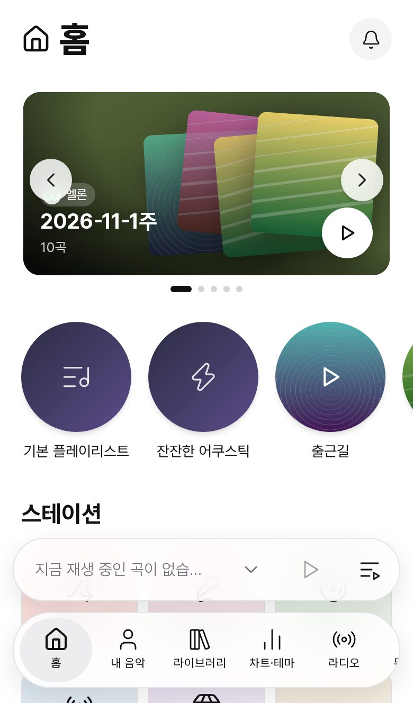
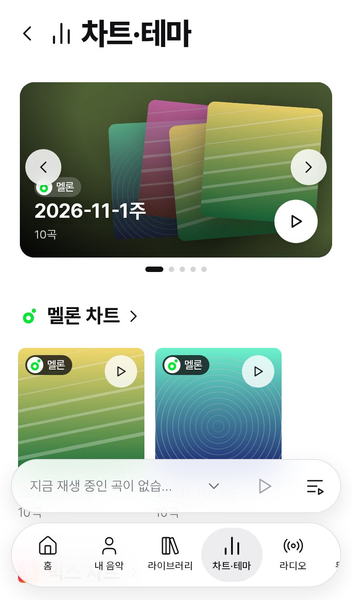
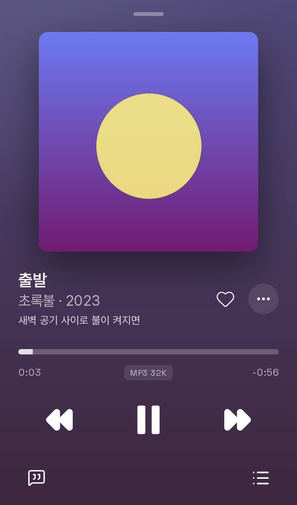
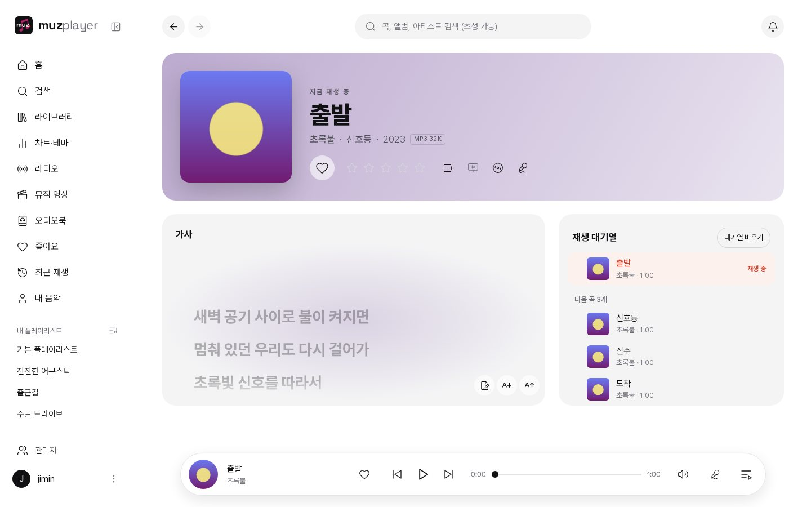

<p align="center">
  
</p>

<h1 align="center">muzplayer</h1>

<p align="center">
  A self-hosted web player for the music, audiobooks and music videos on your NAS — each family member with their own account<br>
  Docker · installable on phones (PWA) · Windows app · Korean / English
</p>

<p align="center">
  <a href="LICENSE"></a>
  <a href="https://hub.docker.com/r/zardkim/muzplayer"></a>
  <a href="https://hub.docker.com/r/zardkim/muzplayer"></a>
</p>

<p align="center"><a href="README.md">🇰🇷 한국어</a> | 🇺🇸 English</p>

---

muzplayer reads your NAS music folder as it is and shows it like a streaming app. Files are never moved or changed; the music folder is mounted read-only.

> The app's interface is available in English; the wiki is written in Korean for now.

## Features

- **Library:** albums, artists, songs, covers, genres and folders; search (Korean initial-consonant search too); albums sorted into regular, unofficial, compilation and soundtrack; Hi-Res and Lossless badges
- **Player:** synced lyrics (.lrc or tags; otherwise looked up on AlSong, Bugs and LRCLIB), an admin lyrics manager, gapless preloading, crossfade, ReplayGain, 10-band EQ, streaming quality, offline downloads
- **For you:** mixes, stations and radio (similar songs keep playing), smart playlists, likes and star ratings, copy or move between playlists
- **Charts & themes:** weekly chart folders (Melon, Bugs) and themed collections shown as banners (optional AI banners)
- **Radio:** Korean radio stations relayed live, with a frequency-dial tuner
- **Music videos:** YouTube and NAS video files; extract the audio as m4a/mp3 with tags, cover and lyrics filled in
- **Audiobooks:** chapters, speed, sleep timer, resume on any device, import from Audiobookshelf
- **Multiple users:** per-account history, likes and playlists; sign-up approval; an admin page (scan, backup and restore, statistics)
- **Everywhere:** install on phones (PWA) with lock-screen controls, any desktop browser, the Windows app

## Screenshots

<table>
  <tr>
    <td align="center"></td>
    <td align="center"></td>
    <td align="center"></td>
    <td align="center"></td>
  </tr>
</table>



> Artists, songs, books, covers and lyrics in the screenshots are made up for the demo.

## Install (Docker Compose)

Two containers: `app` and `db` (PostgreSQL). No build needed.

```bash
mkdir -p /srv/muzplayer && cd /srv/muzplayer
curl -fsSLo docker-compose.yml https://raw.githubusercontent.com/zardkim/muzplayer/main/deploy/docker-compose.yml
curl -fsSLo .env https://raw.githubusercontent.com/zardkim/muzplayer/main/deploy/.env.example
```

Edit `.env` — at least:

| Setting | Meaning |
|---|---|
| `MUZPLAYER_DIR` | Absolute path of this folder; `app`, `db`, `conf` and `library` are created under it |
| `POSTGRES_PASSWORD` | A long random string; don't change it after the first start |
| `PUID` / `PGID` | The user the app runs as (`id <user>`); it must be able to read the music |
| `HTTP_PORT` | Port to open (default `18150`) |
| `DEFAULT_LOCALE` | `en` for English by default |

Bind-mount your music into `library/music` (audiobooks into `library/audiobook`, videos into `library/video`) — symbolic links don't work:

```bash
mkdir -p library/music
sudo mount --bind /path/to/music library/music
docker compose up -d
```

Open `http://<host>:18150`: the first account created there becomes the admin, so create it before exposing the app. Then choose the library folder kinds in the admin page and start a scan. Running behind an HTTPS reverse proxy is recommended (`COOKIE_SECURE=true` is the default).

## Update

```bash
docker compose pull && docker compose up -d
```

Database migrations run by themselves when the app starts.

## External services and trademarks

- Album details, ratings, artist names and lyrics come from Bugs, Melon, AlSong, LRCLIB, MusicBrainz, Wikidata and others; some of these are **unofficial integrations** that may stop working and are subject to each service's terms. Use them for personal, non-commercial purposes.
- Broadcaster and chart logos are trademarks of their owners, shown only to identify them; muzplayer is not affiliated with them.
- Extracting audio from YouTube is off by default; use it only for videos you have the rights to.

## License

muzplayer is released under the [GNU General Public License v3.0 or later](LICENSE). Copyright (C) 2026 zardkim.

Third-party software and licenses (FFmpeg LGPL build, mutagen GPL and others): [THIRD_PARTY_NOTICES.md](THIRD_PARTY_NOTICES.md).
