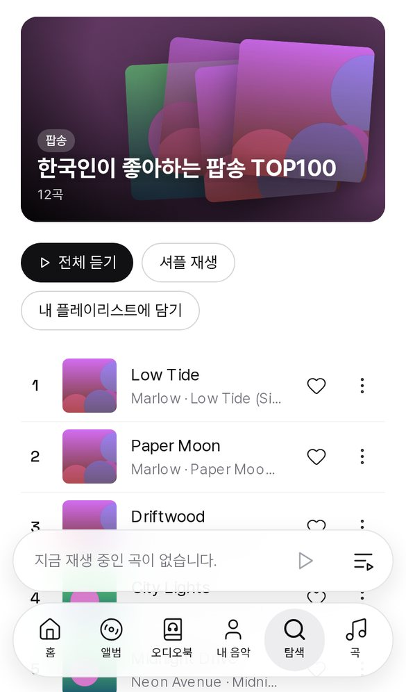

<p align="center">
  
</p>

<h1 align="center">muzplayer</h1>

<p align="center">
  NAS에 있는 음악과 오디오북을 가족·지인이 각자 계정으로 듣는 개인용 웹 플레이어<br>
  Synology NAS · Docker · 휴대폰 앱처럼 설치(PWA) · 한국어 / English
</p>

---

## 소개

muzplayer는 NAS의 음악 폴더를 그대로 읽어 스트리밍 앱처럼 보여 줍니다. 파일을 옮기거나 변환하지 않고, 폴더는 읽기 전용으로만 씁니다.

- **음악:** 앨범·아티스트·곡·장르 목록, 검색, 즐겨찾기, 내 플레이리스트, 최근 재생, 가사(`.lrc`·가사 태그, 시간 정보가 있으면 따라감)
- **차트·테마:** 멜론·벅스 주차별 차트 폴더와 "카페에서 듣기 좋은 노래" 같은 테마 모음 폴더를 배너 슬라이드와 추천 줄로 보여 줌.
  배너는 관리자가 AI(Gemini, OpenAI)로 만들고 말로 고칠 수 있음
- **오디오북:** 챕터·속도(0.75~2.5배)·±건너뛰기·취침 타이머, 사용자별 이어 듣기(기기를 바꿔도 이어짐),
  Audiobookshelf에서 책 정보·듣던 위치 가져오기
- **여러 사용자:** 계정마다 즐겨찾기·플레이리스트·재생 기록·듣던 위치가 따로 저장됨. 관리자 화면에서 계정·스캔 관리
- **휴대폰:** 홈 화면에 추가하면 앱처럼 실행, 잠금화면 재생 조작

## 스크린샷

<table>
  <tr>
    <td align="center"><br>홈</td>
    <td align="center"><br>차트·테마</td>
    <td align="center"><br>테마 모음</td>
  </tr>
  <tr>
    <td align="center"><br>재생 화면</td>
    <td align="center"><br>오디오북</td>
    <td align="center"><br>오디오북 재생</td>
  </tr>
</table>


> 스크린샷의 가수·곡·책 이름과 커버는 모두 데모용으로 만든 것입니다.

## 설치 (Synology NAS)

빌드는 필요 없습니다. 이미지를 받고 `.env`만 채우면 됩니다. 컨테이너는 `app`과 `db`(PostgreSQL) 두 개입니다.

### 1. 파일 준비

NAS에 폴더를 만들고 이 저장소의 두 파일을 복사합니다.

```
/volume1/docker/muzplayer/
├── docker-compose.yml   ← deploy/docker-compose.yml (수정하지 않음)
└── .env                 ← deploy/.env.example 을 복사해서 값 입력
```

### 2. 레지스트리 로그인 (처음 한 번)

```bash
echo '<시크릿>' | docker login harbor.nurilab.pe.kr -u 'robot$muzplayer+deploy' --password-stdin
```

### 3. `.env` 설정

| 항목 | 설명 |
|---|---|
| `MUZPLAYER_VERSION` | 실행할 버전(예: `0.5.0`). `latest`는 최신 빌드 |
| `HTTP_PORT` | NAS에서 열 포트. 역방향 프록시는 `http://<NAS>:<HTTP_PORT>`로 연결 |
| `MUSIC_PATH` | 음악 폴더. 안의 심볼릭 링크 폴더와 마운트된 공유 폴더도 스캔 |
| `MUSIC_ROOT` | 컨테이너에 같은 경로로 읽기 전용 연결할 폴더. 보통 `MUSIC_PATH`와 같게 두고, 링크가 음악 폴더 밖을 가리키면 둘을 포함하는 상위 폴더(예: `/volume1`) |
| `AUDIOBOOK_PATH` | 오디오북 폴더(읽기 전용). 비워 두면 오디오북 메뉴가 숨겨짐 |
| `GEMINI_API_KEY` | 차트·테마 배너를 AI로 만들 때만 필요(선택). 비워 두면 AI 버튼이 숨겨짐 |
| `DATA_PATH` | DB와 커버 캐시를 저장할 폴더 |
| `PUID` / `PGID` | 앱이 실행될 사용자(`id <사용자>`로 확인). 음악 폴더를 읽을 수 있어야 함 |
| `POSTGRES_PASSWORD` | 긴 임의 문자열. 처음 실행한 뒤에는 바꾸지 않음 |
| `ADMIN_USERNAME` / `ADMIN_PASSWORD` | 사용자가 없을 때 만들 첫 관리자. 첫 로그인 뒤 비밀번호 줄은 지워도 됨 |
| `SCAN_INTERVAL_MINUTES` | 자동 재스캔 주기(기본 60분, `0`이면 수동만) |
| `COOKIE_SECURE` | HTTPS 뒤에서는 `true`. IP로 직접 테스트할 때만 `false` |

나머지 항목(`AI_PROVIDER`, `OPENAI_API_KEY`, `MUSIC_MOUNT_PROPAGATION` 등)은 `deploy/.env.example`의 설명을 참고하세요.

### 4. 실행

```bash
cd /volume1/docker/muzplayer
docker compose up -d
```

DB 준비와 첫 관리자 계정 생성은 시작할 때 자동으로 됩니다. 관리자로 로그인한 뒤 다음 순서로 진행합니다.

1. 관리자 화면 → **라이브러리 폴더**에서 음악 폴더 바로 아래 폴더마다 종류를 고릅니다(아래 "폴더 구조").
2. **스캔 시작**을 누릅니다.
3. 관리자 화면 → **사용자**에서 가족·지인 계정을 만듭니다.

### 5. 휴대폰에서 앱처럼 쓰기

- **iPhone:** Safari → 공유 → **홈 화면에 추가**
- **Android:** Chrome → 설정 화면의 **앱으로 설치**

### 업데이트

`.env`의 `MUZPLAYER_VERSION`을 바꾼 뒤:

```bash
docker compose pull && docker compose up -d
```

| 버전 | 해야 할 일 |
|---|---|
| 0.1 → 0.2 | 새 `docker-compose.yml`로 교체, `.env`에 `MUSIC_ROOT` 추가(보통 `MUSIC_PATH`와 같은 값) |
| 0.2 → 0.3 | 라이브러리 폴더에서 차트·컴필레이션 폴더 종류를 고르고 스캔(DB 백업 권장) |
| 0.3 → 0.4 | 새 `docker-compose.yml`로 교체. 오디오북을 쓰려면 `.env`에 `AUDIOBOOK_PATH` 추가(DB 백업 권장) |
| 0.4 → 0.5 | 새 `docker-compose.yml`로 교체. 테마 폴더를 라이브러리 폴더에서 `테마`로 지정하고 스캔. AI 배너를 쓰려면 `GEMINI_API_KEY` 추가(선택) |

## 폴더 구조

앨범·아티스트는 파일 태그로 묶습니다. 폴더에서 읽는 것은 **음악 폴더 바로 아래 폴더의 종류**와 **`비정규` 폴더 여부**뿐입니다.

```
music/                                      ← MUSIC_PATH
├── album/                                  ← 종류: 앨범 (기본값)
│   └── 아티스트/[2017] 앨범명/01 곡.flac
│       └── 비정규/[2019] 라이브/            ← 비정규 앨범으로 표시 (`비정규` 또는 `Unofficial`)
├── chart music/                            ← 종류: 차트
│   └── 멜론/2026-10-4주/001 가수 - 제목.mp3  ← 폴더 하나 = 차트 하나, 바로 아래 폴더 = 출처
├── theme music/                            ← 종류: 테마
│   ├── 팝송/한국인이 좋아하는 팝송 TOP100/   ← 폴더 하나 = 테마 하나, 중간 폴더 = 분류
│   ├── 카페에서 듣기 좋은 노래/banner.jpg    ← banner.jpg가 있으면 배너로 사용
│   └── 2020년 걸그룹 노래 모음/CD1, CD2/     ← CD 폴더는 한 모음으로 합침
└── audiobook/                              ← AUDIOBOOK_PATH (음악 스캔에서 자동 제외)
```

**종류**

| 종류 | 처리 |
|---|---|
| 앨범 | 아티스트/앨범으로 묶음 |
| 컴필레이션 | 앨범 아티스트 태그가 없으면 Various Artists로 묶음 |
| 차트 | 앨범 목록에 넣지 않고 차트로 보여 줌 |
| 테마 | 앨범 목록에 넣지 않고 테마 모음으로 보여 줌 |
| 제외 | 스캔하지 않음 |

종류는 관리자 화면 **라이브러리 폴더**에서 고르고, 다음 스캔부터 반영됩니다.

**차트·테마**

- 곡 순서는 파일명 앞 번호(`001 …`) → 트랙 번호 태그 → 파일명 순서입니다.
- 차트·테마 곡도 곡 목록과 검색에는 나옵니다. 같은 곡이 여러 곳에 있으면 최신 차트 주차의 파일 하나만 보입니다.

**파일 이름과 가사**

- 파일·폴더 이름에는 `: ? * " < > |`와 끝의 마침표를 쓰지 않습니다(SMB 호환).
- 가사는 곡과 같은 이름의 `.lrc`(UTF-8·CP949) 또는 파일의 가사 태그에서 읽습니다.

**링크와 마운트**

- 링크된 폴더도 따라가 스캔합니다.
- 끊긴 링크나 꺼진 공유 폴더 아래 곡은 "없어짐"으로 처리하지 않습니다.
- 음악 폴더 전체가 비어 보이면 스캔을 멈춥니다.

### 재생 형식

변환 없이 원본을 그대로 보냅니다.

| 형식 | 재생되는 곳 |
|---|---|
| MP3 · AAC(m4a) · FLAC · WAV | 어디서나 |
| ALAC · AIFF | iPhone Safari |
| OGG / Opus | Chrome · Android (iPhone은 버전에 따라 다름) |
| WMA · APE | 브라우저가 재생하지 못해 건너뜀 |

## 차트·테마 배너

탐색 → **차트·테마** 맨 위에는 배너 슬라이드가 있습니다. 출처별 최신 차트와 오늘의 테마가 나오고, 홈 맨 위에도 같은 슬라이드가 보입니다.

배너는 아래 순서에서 먼저 있는 것을 씁니다. 제목 글자는 이미지에 그리지 않고 화면에서 위에 얹습니다.

1. 그 모음에 만든 AI 배너
2. 차트 출처 전체 배너(예: 멜론의 모든 주차가 함께 씀)
3. 모음 폴더의 `banner.jpg`(·`.png`·`.webp`)
4. 상위 곡 커버로 자동으로 그린 배너

**AI 배너 만들기**

- `.env`에 `GEMINI_API_KEY`를 넣으면 관리자에게 차트·테마 상세 화면의 **AI 배너** 버튼이 보입니다.
- OpenAI를 쓰려면 `AI_PROVIDER=openai`와 `OPENAI_API_KEY`를 넣습니다.
- 앱이 채워 준 프롬프트로 만든 뒤, "더 따뜻한 색으로"처럼 말로 고치고 적용합니다.
- 만들기·고치기 한 번마다 유료 이미지 요청이 한 번 나갑니다(Gemini 2K 기준 약 $0.05).
- 키는 서버에만 있고 화면이나 DB에 남지 않습니다.
- 오류가 나면 `docker compose logs app | grep "ai banner"`에서 이유를 볼 수 있습니다.

## 오디오북

`AUDIOBOOK_PATH` 폴더를 직접 읽어 재생합니다. Audiobookshelf 없이도 동작하고, 책을 묶는 규칙은 Audiobookshelf와 같습니다.

```
audiobook/
├── 저자/시리즈/1권 제목/book.m4b, cover.jpg   ← 저자/시리즈/책
├── 저자/책 제목/CD1/01.mp3, CD2/01.mp3        ← CD·Disc 폴더는 같은 책
└── 낱권.m4b                                    ← 맨 위의 파일 하나 = 책 하나
```

- **책 정보:** 첫 파일의 태그에서 읽습니다(앨범=제목, 아티스트=저자, 작곡가=내레이터). 태그가 없으면 폴더 이름을 씁니다.
- **챕터:** `.m4b`·mp3 안의 챕터를 씁니다. 없으면 파일마다 챕터 하나입니다.
- **커버:** 폴더의 이미지를 먼저 쓰고, 없으면 파일 안의 커버를 씁니다.
- **듣던 위치:** 사용자별로 서버에 저장되어 다른 기기에서 이어 듣습니다.

**Audiobookshelf에서 옮기기**

1. Audiobookshelf와 같은 폴더를 `AUDIOBOOK_PATH`로 지정하고 스캔합니다.
2. 관리자 화면 → 오디오북 → **Audiobookshelf에서 가져오기**에 주소와 관리자 API 키(Audiobookshelf 설정 → API Keys)를 넣습니다.
3. 편집한 책 정보·챕터·커버와 사용자별 듣던 위치를 한 번 가져옵니다. 키는 저장하지 않습니다.
4. 가져온 정보는 다시 스캔해도 태그로 덮어쓰지 않습니다. 이후에는 Audiobookshelf를 꺼도 됩니다.

## 백업·복구

DB에는 계정·플레이리스트·즐겨찾기·재생 기록·듣던 위치가 들어 있습니다. 커버 캐시는 다시 스캔하면 새로 만들어집니다.

Synology 작업 스케줄러(매일, root)에 등록합니다.

```bash
cd /volume1/docker/muzplayer && mkdir -p backup && \
docker compose exec -T db pg_dump -U muzplayer -Fc muzplayer > backup/muzplayer-$(date +%F).dump && \
find backup -name 'muzplayer-*.dump' -mtime +14 -delete
```

복구:

```bash
docker compose stop app
docker compose exec -T db pg_restore -U muzplayer -d muzplayer --clean --if-exists < backup/muzplayer-YYYY-MM-DD.dump
docker compose start app
```

## 개발

개발 환경, 구조, 빌드·릴리스, 테스트는 이 저장소의 **위키**에 있습니다. 기능 계획과 변경 이력은
[music_player_plan.md](music_player_plan.md), 화면 디자인 기준은 [docs/design.md](docs/design.md)에 있습니다.
