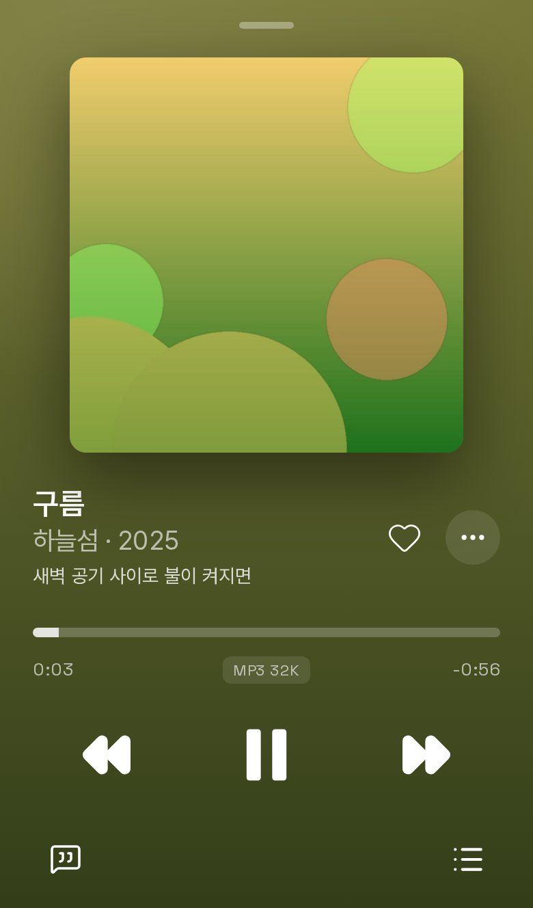
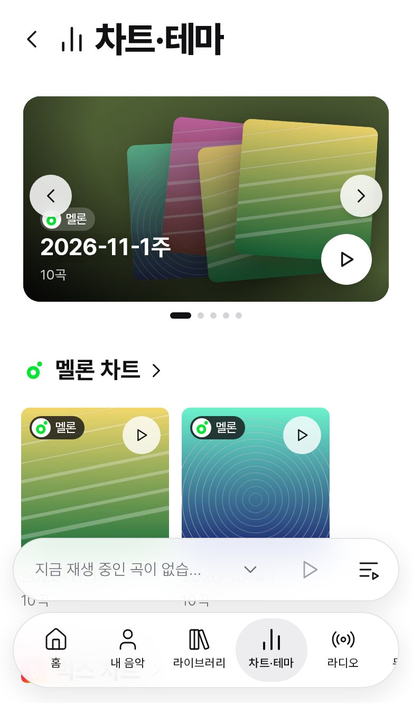
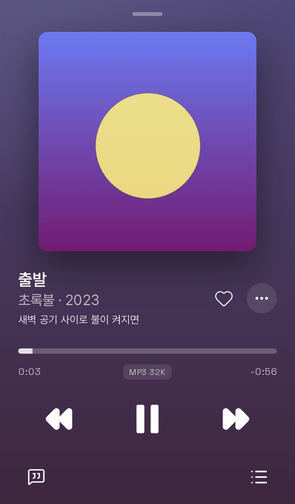
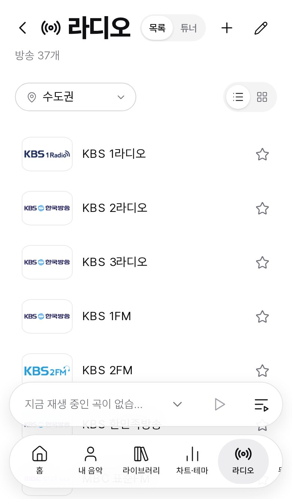
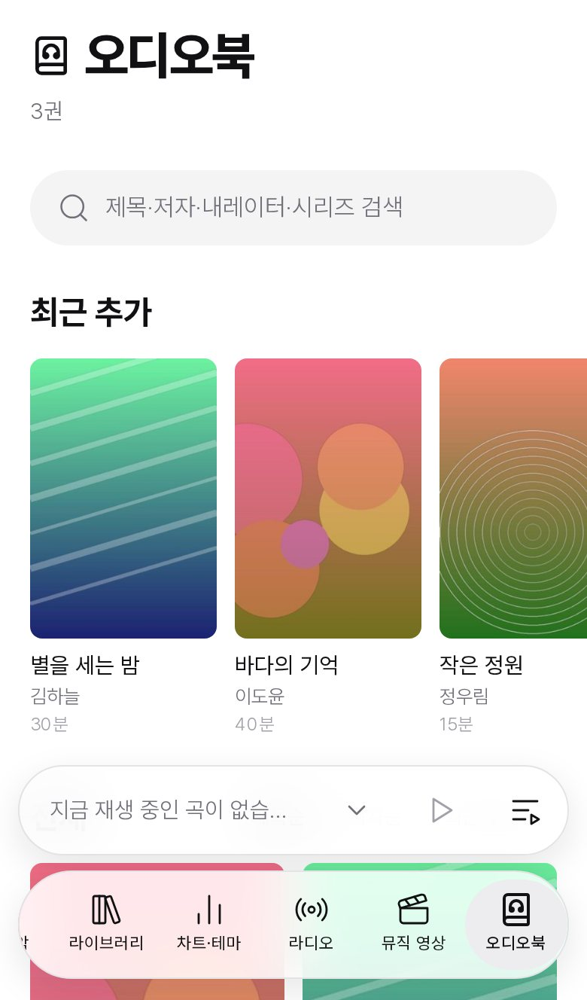
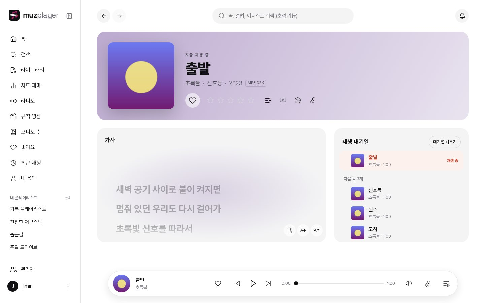
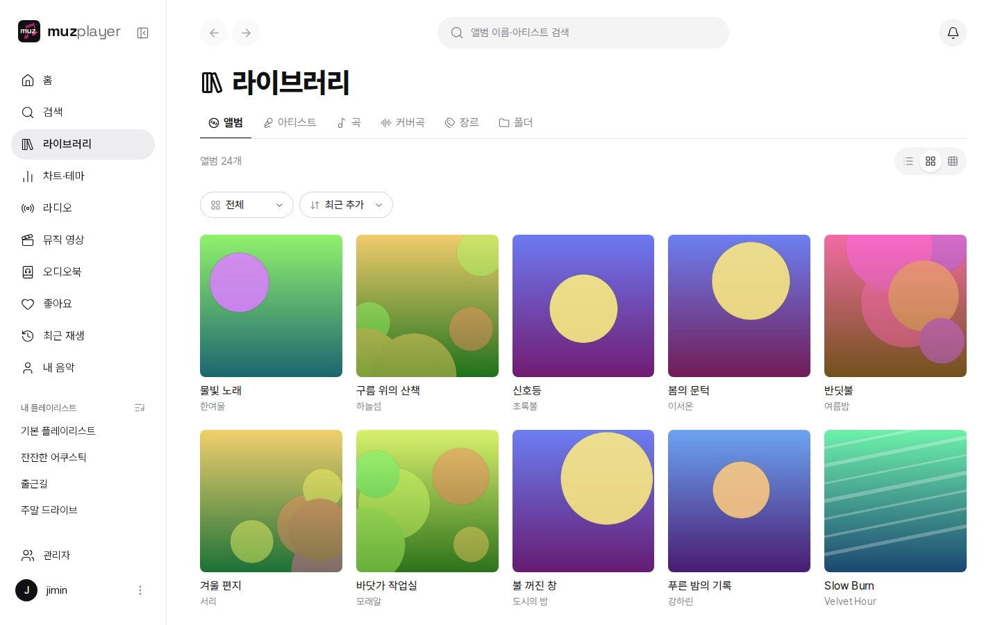
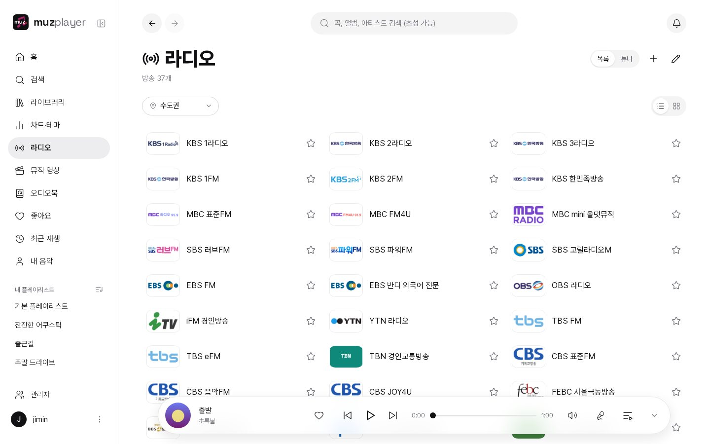
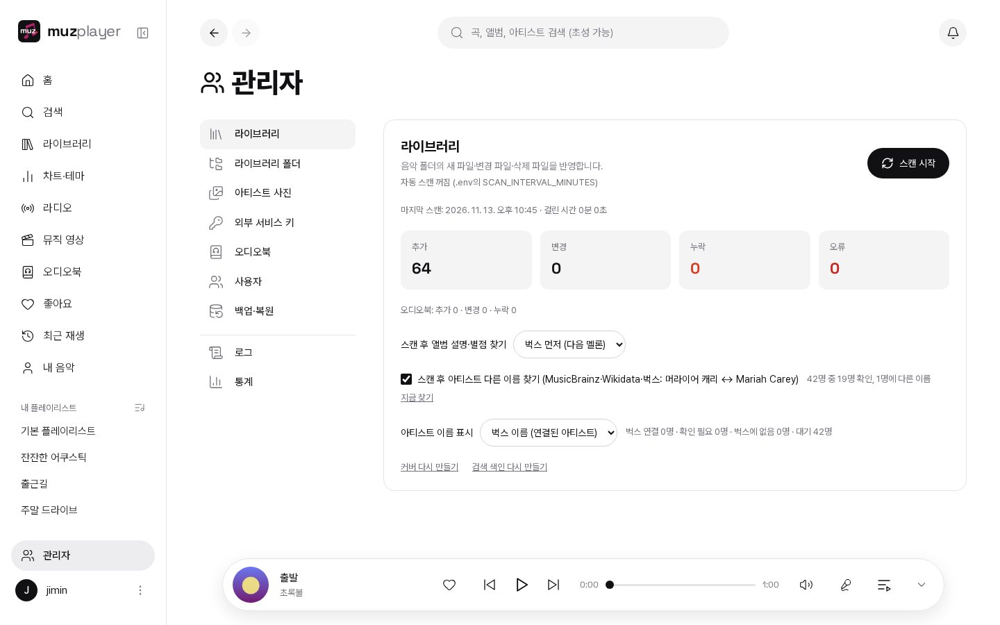

<p align="center">
  
</p>

<h1 align="center">muzplayer</h1>

<p align="center">
  NAS에 있는 음악·오디오북·뮤직 영상을 가족·지인이 각자 계정으로 듣는 셀프호스팅 웹 플레이어<br>
  Docker · 휴대폰 앱처럼 설치(PWA) · Windows 앱 · 한국어 / English
</p>

<p align="center">
  <a href="LICENSE"></a>
  <a href="https://hub.docker.com/r/zardkim/muzplayer"></a>
  <a href="https://hub.docker.com/r/zardkim/muzplayer"></a>
</p>

<p align="center">🇰🇷 한국어 | <a href="README.en.md">🇺🇸 English</a></p>

---

muzplayer는 NAS의 음악 폴더를 그대로 읽어 스트리밍 앱처럼 보여 줍니다. 파일을 옮기거나 바꾸지 않고, 음악 폴더는 읽기 전용으로만 씁니다.

## 주요 기능

- **라이브러리:** 앨범·아티스트·곡·커버곡·장르·폴더, 한글 초성 검색, 정규·비정규·컴필레이션·OST 자동 분류, Hi-Res·Lossless 표시
- **플레이어:** 싱크 가사(.lrc·태그, 없으면 알송·벅스·LRCLIB에서 자동으로), 관리자 가사 관리, 끊김 없는 재생, 크로스페이드, ReplayGain, 10밴드 EQ, 스트리밍 품질 선택, 오프라인 저장
- **나를 위한 음악:** 믹스, 스테이션·라디오(비슷한 곡 이어 듣기), 스마트 재생목록, 좋아요·별점, 플레이리스트 복사·이동
- **차트·테마:** 멜론·벅스 주차별 차트 폴더와 테마 모음을 배너와 추천 줄로(AI 배너 선택)
- **라디오:** 전국 라디오 방송을 실시간으로 중계, 주파수 다이얼 튜너
- **뮤직 영상:** YouTube·NAS 영상 등록과 재생, 영상에서 음원 추출(m4a/mp3, 태그·커버·가사 자동)
- **오디오북:** 챕터·속도·취침 타이머, 기기를 바꿔도 이어 듣기, Audiobookshelf에서 가져오기
- **여러 사용자:** 계정별 기록·좋아요·플레이리스트, 회원가입 승인, 관리자 화면(스캔·백업·복원·통계)
- **어디서나:** 휴대폰 홈 화면에 설치(PWA)·잠금 화면 조작, PC 브라우저, [Windows 앱](https://github.com/zardkim/muzplayer/wiki/Windows-앱)

자세한 설명은 [위키](https://github.com/zardkim/muzplayer/wiki)에 있습니다.

## 스크린샷

<table>
  <tr>
    <td align="center"><br>홈</td>
    <td align="center"><br>재생 화면</td>
    <td align="center"><br>차트·테마</td>
    <td align="center"><br>모던 다크 테마</td>
  </tr>
  <tr>
    <td align="center"><br>라디오</td>
    <td align="center"><br>오디오북</td>
    <td align="center"><br>내 플레이리스트</td>
    <td></td>
  </tr>
</table>



<details>
<summary>PC 화면 더 보기</summary>







</details>

> 스크린샷의 가수·곡·책 이름, 커버, 가사는 모두 데모용으로 만든 것입니다.

## 설치 (Docker Compose)

컨테이너는 `app`과 `db`(PostgreSQL) 두 개입니다. 빌드는 필요 없습니다.

**1. 폴더와 파일 준비**

```bash
mkdir -p /volume1/docker/muzplayer && cd /volume1/docker/muzplayer
curl -fsSLo docker-compose.yml https://raw.githubusercontent.com/zardkim/muzplayer/main/deploy/docker-compose.yml
curl -fsSLo .env https://raw.githubusercontent.com/zardkim/muzplayer/main/deploy/.env.example
```

**2. `.env` 고치기** — 최소한 다음 네 가지를 정합니다.

| 항목 | 설명 |
|---|---|
| `MUZPLAYER_DIR` | 이 폴더의 절대 경로(예: `/volume1/docker/muzplayer`). 아래에 `app`·`db`·`conf`·`library`가 생깁니다 |
| `POSTGRES_PASSWORD` | 긴 임의 문자열. 처음 실행한 뒤에는 바꾸지 않습니다 |
| `PUID` / `PGID` | 앱을 실행할 사용자(`id <사용자>`로 확인). 음악 폴더를 읽을 수 있어야 합니다 |
| `HTTP_PORT` | 열 포트(기본 `18150`) |

**3. 음악 폴더 연결** — 음악을 `library/music`에(오디오북은 `library/audiobook`, 영상은 `library/video`에) bind 마운트합니다.

```bash
mkdir -p library/music
sudo mount --bind /volume1/music library/music      # Synology는 작업 스케줄러 → 부트업에 등록
```

심볼릭 링크로는 안 됩니다. 자세한 방법은 위키의 [설치](https://github.com/zardkim/muzplayer/wiki/설치)를 보세요.

**4. 실행**

```bash
docker compose up -d
```

브라우저로 `http://<NAS>:18150`을 열면 **관리자 계정 만들기** 화면이 나옵니다. 처음 만든 계정이 관리자가 되므로, 외부에 열기 전에 먼저 만드세요.
그다음 관리자 화면에서 **라이브러리 폴더 종류**를 고르고 **스캔**을 누릅니다.

- 휴대폰: Safari → 공유 → **홈 화면에 추가** / Chrome → **앱으로 설치**
- HTTPS 역방향 프록시 뒤에서 쓰는 것을 권장합니다(`COOKIE_SECURE=true`가 기본값).
- Portainer에서는 compose 내용을 스택에 붙이고 `.env` 값을 스택 환경 변수로 넣습니다.

## 업데이트

```bash
docker compose pull && docker compose up -d
```

DB 변경은 앱이 시작할 때 자동으로 적용됩니다. 버전별로 따로 할 일은 위키의 [업데이트](https://github.com/zardkim/muzplayer/wiki/업데이트)에 있습니다.

## 문서

| | |
|---|---|
| [설치](https://github.com/zardkim/muzplayer/wiki/설치) | 폴더 구조, `.env` 전체, Synology·Portainer, 처음 설정 |
| [라이브러리](https://github.com/zardkim/muzplayer/wiki/라이브러리) | 폴더 종류, 태그 규칙, 가사·아티스트 사진, 스캔 |
| [기능](https://github.com/zardkim/muzplayer/wiki/기능) | 전체 기능 설명 |
| [백업과 복구](https://github.com/zardkim/muzplayer/wiki/백업과-복구) | 앱 백업·복원, 명령으로 백업 |
| [개발](https://github.com/zardkim/muzplayer/wiki/개발) | 직접 빌드, 로컬 개발, 테스트 |

## 외부 서비스와 상표

- 앨범 정보·별점·아티스트 이름·가사는 벅스·멜론·알송·LRCLIB·MusicBrainz·Wikidata 등에서 가져오며, 일부는 **비공식 연동**입니다.
  서비스 쪽 변경으로 동작하지 않을 수 있고, 각 서비스 약관을 따릅니다. 개인적·비상업적 용도로 쓰세요.
- 방송사·차트 로고는 각 소유자의 상표이며 방송과 차트를 구분하는 용도로만 표시합니다. muzplayer는 이들과 관계가 없습니다.
- YouTube 음원 추출은 기본으로 꺼져 있습니다. 권리가 있거나 허락된 영상에만 사용하세요.

## 라이선스

muzplayer는 [GNU General Public License v3.0 or later](LICENSE)로 배포됩니다. Copyright (C) 2026 zardkim.

사용한 오픈소스와 각 라이선스(FFmpeg LGPL 빌드, mutagen GPL 등)는 [THIRD_PARTY_NOTICES.md](THIRD_PARTY_NOTICES.md)에 있습니다.
