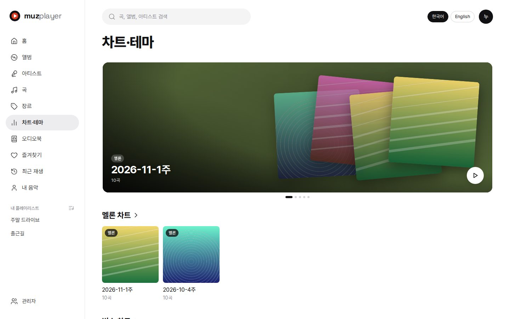

<p align="center">
  
</p>

<h1 align="center">muzplayer</h1>

<p align="center">
  NAS에 있는 음악과 오디오북을 가족·지인이 각자 계정으로 듣는 개인용 웹 플레이어<br>
  Synology NAS · Docker · 휴대폰 앱처럼 설치(PWA) · 한국어 / English
</p>

---

## 소개

muzplayer는 NAS의 음악 폴더를 그대로 읽어 스트리밍 앱처럼 보여 줍니다. 파일을 옮기거나 변환하지 않고, 폴더는 읽기 전용으로만 씁니다.

- **음악:** 라이브러리 메뉴 하나에 앨범·아티스트·곡·장르·폴더 탭(목록형·커버형·격자형, 폴더는 음악 폴더 구조 그대로), 검색, 내 플레이리스트, 최근 재생, 가사(`.lrc`·가사 태그, 시간 정보가 있으면 노래를 따라감)
- **아티스트 사진:** 아티스트 폴더의 `artist.jpg`, 없으면 위키백과에서 찾아옴
- **PC 화면:** 사이드바·하단 플레이어와 함께 보는 재생 페이지(곡 정보, 가사·대기열을 나란히), 뒤로·앞으로 버튼, 하단 플레이어 숨기기, 사이드바 접기
- **설정:** 재생하면 재생 화면 열기, 재생 화면을 보는 동안 화면 켜짐 유지, 음악 재생 속도(0.75~1.5배), 앨범 연도·음량 막대 표시, 재생 기록 남기지 않기(계정별)
- **끊김 없이 듣기:** 재생 중에 대기열의 다음 곡을 미리 받아 둠(Wi-Fi·모바일 데이터별 곡 수, 기기에 남길 캐시 크기, 캐시 지우기)
- **자동재생·라디오:** 대기열이 끝나면 비슷한 곡(같은 가수·장르·연대, 내 좋아요·별점)을 이어서 재생. 앨범을 다 들은 뒤에는 비슷한 곡 / 같은 가수의 다음 앨범 / 멈춤 중 선택. 곡 메뉴의 "이 곡으로 라디오"
- **음질·인기 표시:** 재생 화면에 FLAC 24/96·MP3 320k 같은 형식과 음질, 앨범에 Lossless·Hi-Res 배지, 앨범에서 가장 많이 들은 곡에 "인기" 표시
- **홈 화면:** 줄(배너, 오늘에, 믹스, 최근 재생, 오디오북, 최근 추가)을 켜고 끄고 순서를 바꿈(계정별). "오늘에"는 N년 전 오늘 나온 앨범(태그에 발매일 전체가 있을 때)
- **사운드:** 음량 레벨링(ReplayGain, 곡·앨범 기준), 크로스페이드(2~8초), 10밴드 이퀄라이저와 프리셋. iPhone에서는 레벨링을 서버가 맞춰 보내고(화면이 꺼져도 안전), 크로스페이드·이퀄라이저는 화면이 꺼지면 소리가 멈출 수 있어 기본으로 꺼 둠
- **스트리밍 품질:** 원본 / 320 / 256 / 192 / 128kbps(Wi-Fi·모바일 데이터 따로, 모바일 데이터 구분은 안드로이드만). 서버가 MP3로 바꿔 보냄(이미지에 든 ffmpeg). 브라우저가 못 트는 WMA·APE(크롬의 AIFF)도 변환해서 재생
- **기기(원격 제어):** 같은 계정으로 연 다른 기기(휴대폰·PC)가 무엇을 듣는지 보고 재생·일시정지·이전·다음·이동·음량을 조종하거나, 듣던 곡을 이 기기로 가져오거나 보냄. 플레이어의 기기 버튼 또는 계정 메뉴 → 기기. 화면이 꺼진 iPhone은 연결이 끊겨 조종할 수 없음
- **크롬캐스트·AirPlay:** PC·안드로이드 크롬에서 대기열을 크롬캐스트로 보냄(https 주소에서만, 크롬캐스트가 서명된 기한부 주소로 곡을 직접 받음). Safari에서는 AirPlay 선택 창
- **사용자 전환:** 계정 메뉴 → 다른 계정 추가로 가족 계정을 한 기기에 함께 로그인해 두고 바로 전환. 관리자 계정으로 전환할 때는 비밀번호를 물음
- **AI 재생목록:** 내 플레이리스트 → AI로 만들기. "비 오는 날 잔잔한 발라드" 같은 문장을 내 라이브러리의 장르·가수·연도 조건(스마트 재생목록)으로 바꿔 줌. 관리자가 넣은 AI 키(배너와 같은 키)를 쓰고, 모든 계정이 쓸 수 있음
- **검색:** 스캔할 때 곡·앨범·아티스트의 검색 색인을 만들어 둠. 검색어의 단어가 모두 들어 있으면 순서·대소문자·띄어쓰기·문장부호와 상관없이 찾고("아이유 밤편지", "밤편지"→"밤 편지"), 한글 초성으로도 찾음("ㅂㅍㅈ"). 제목이 맞는 곡이 먼저 나옴. 관리자 화면에서 색인을 다시 만들 수 있음
- **가사 자동 가져오기:** 싱크 가사(.lrc나 태그)가 없는 곡은 재생할 때 eztag처럼 알송(파일 일치)·벅스·LRCLIB·알송(제목)에서 찾아 DB에 저장하고 표시. 못 찾은 곡은 30일 뒤 다시 찾음. 가사 화면은 앨범아트 색이 은은하게 비치는 투명 그라데이션, 글씨 크기 조절(A−/A+)
- **제스처(휴대폰):** 재생 화면·오디오북 재생 화면·아래에서 올라오는 창은 아래로 쓸어 닫기, 대기열은 오른쪽으로 밀어 닫기. 앨범아트·미니 플레이어를 좌우로 밀어 이전·다음 곡(오디오북은 앞뒤로 건너뛰기), 미니 플레이어를 위로 밀어 열기, 앨범아트 두 번 탭으로 좋아요. 곡 목록은 오른쪽으로 밀어 다음에 재생·왼쪽으로 밀어 좋아요·길게 눌러 메뉴, 대기열은 왼쪽으로 밀어 빼기·길게 눌러 끌어 순서 바꾸기
- **출력 장치:** 기기 화면에서 이 기기의 출력을 고름(iPhone은 스피커·블루투스·AirPlay 선택 창, PC 크롬은 목록). 안드로이드는 블루투스를 연결하면 자동으로 그쪽으로 재생되고, 바꾸기는 알림창의 미디어 카드에서
- **회원가입·사용자 관리:** 관리자 화면에서 회원가입을 "받지 않음 / 관리자 승인 후 사용 / 바로 사용" 중에서 고름. 승인 방식이면 가입 신청이 "승인 대기"로 올라오고 승인·거절. 사용자마다 이름·관리자 권한 편집, 비밀번호 초기화, 비활성화, 삭제(그 사람의 재생목록·좋아요·기록도 지움), 가입일·최근 로그인 표시
- **홈 재생목록:** 배너 아래 둥근 카드로 "랜덤 100"과 내 플레이리스트. 누르면 바로 재생, 이름을 누르면 플레이리스트 열기
- **플레이어 바 숨기기:** 휴대폰은 미니 플레이어를 아래로 쓸거나(재생 중이 아닐 때는 ∨ 버튼) 숨기고, 오른쪽 아래 작은 버튼으로 다시 보임. 무언가 재생을 시작하면 저절로 다시 나타남(PC도 같음)
- **손상된 MP3:** 태그 뒤에 쓰레기 데이터·깨진 그림이 끼어 "can't sync to MPEG frame"이 나는 MP3는 ffmpeg로 읽어 등록하고, 재생할 때 서버가 깨끗한 MP3로 변환해 보냄. ffmpeg로도 못 읽는 파일은 관리자 화면 → 스캔 → 오류 내용 보기에서 파일마다 원인과 조치(다시 받기, MP3val·MP3 Diags로 복구, 권한, 깨진 바로가기)를 안내
- **중복 정리(관리자):** 라이브러리 → 아티스트·장르의 "중복 정리"에서 이름만 다르게 태그된 아티스트("IU"·"아이유 (IU)")나 장르("K-Pop"·"kpop")를 하나로 합침. 비슷한 이름을 제안하고, 직접 골라 합칠 수도 있음. 파일 태그는 그대로 두고 이후 스캔도 합친 이름으로 정리하며, 되돌릴 수 있음
- **앨범 소개:** 앨범 화면 아래에 표시. 앨범 폴더에 eztag가 만든 앨범카드(`[앨범카드] ….html`)가 있으면 그 소개를 쓰고, 없으면 관리자가 "설명 업데이트"에서 벅스·멜론을 검색해 고른 앨범의 소개를 가져오거나 직접 씀
- **다운로드(오프라인):** 앨범·플레이리스트를 기기에 저장해 인터넷 없이 듣기. 내 음악 → 다운로드에서 재생·삭제. https 주소에서만 됨
- **테마:** 기본(흰 화면), Plexamp 스타일(따뜻한 회색 바탕, 주황 강조, 재생 중인 곡의 커버 색이 배경에 번짐), 모던 다크(Spotify 스타일: 검은 바탕, 초록 강조, 커버 색이 위에서 번짐). 설정에서 고르고 브라우저마다 기억함
- **뒤로 가기:** 앱으로 설치해 브라우저 버튼이 없어도 화면 위 뒤로 버튼으로 이동. 휴대폰의 뒤로 동작은 열린 재생 화면·대기열부터 닫음
- **좋아요·별점:** 곡과 앨범에 좋아요와 별 0.5~5개(반 개 단위). 사람마다 따로 저장됨
- **믹스·스마트 재생목록:** 랜덤 100곡, 자주 듣는 곡, 가장 많이 들은 곡, 오랜만에 듣기, 별점 높은 곡, 아직 안 들은 곡, 최근 추가된 곡, 시대별 믹스.
  "★4 이상 + 발라드 + 30일 동안 안 들음"처럼 조건을 정하면 열 때마다 곡이 새로 정해지는 스마트 재생목록
- **영상:** 앨범·곡에 YouTube 뮤직비디오·라이브·커버곡을 검색해서 등록하고 앱 안에서 재생
- **차트·테마:** 멜론·벅스 주차별 차트 폴더와 "카페에서 듣기 좋은 노래" 같은 테마 모음 폴더를 배너 슬라이드와 추천 줄로 보여 줌.
  배너는 관리자가 AI(Gemini, OpenAI)로 만들고 말로 고칠 수 있음
- **오디오북:** 챕터·속도(0.75~2.5배)·±건너뛰기·취침 타이머, 사용자별 이어 듣기(기기를 바꿔도 이어짐),
  Audiobookshelf에서 책 정보·듣던 위치 가져오기
- **여러 사용자:** 계정마다 좋아요·별점·플레이리스트·재생 기록·듣던 위치가 따로 저장됨. 관리자 화면에서 계정·스캔 관리
- **휴대폰:** 홈 화면에 추가하면 앱처럼 실행, 잠금화면 재생 조작

## 스크린샷

<table>
  <tr>
    <td align="center"><br>홈</td>
    <td align="center"><br>차트·테마</td>
    <td align="center"><br>테마 모음</td>
  </tr>
  <tr>
    <td align="center"><br>재생 화면</td>
    <td align="center"><br>오디오북</td>
    <td align="center"><br>오디오북 재생</td>
  </tr>
</table>



> 스크린샷의 가수·곡·책 이름과 커버는 모두 데모용으로 만든 것입니다.

## 설치 (Synology NAS)

빌드는 필요 없습니다. 이미지를 받고 `.env`만 채우면 됩니다. 컨테이너는 `app`과 `db`(PostgreSQL) 두 개입니다.

### 1. 폴더 준비

`.env`의 `MUZPLAYER_DIR`(예: `/volume1/docker/muzplayer`) 아래에 모든 폴더가 처음 실행할 때 자동으로 생깁니다. 미리 만들 폴더는 없습니다.
`docker compose`로 실행하면 이 폴더에 아래 두 파일을 두고, **Portainer**로 실행하면 스택 편집기에 compose 내용을 붙이고 `.env` 값을 스택 환경 변수로 넣습니다.

```
/volume1/docker/muzplayer/
├── docker-compose.yml   ← deploy/docker-compose.yml (수정하지 않음, Portainer면 필요 없음)
├── .env                 ← deploy/.env.example 을 복사해서 값 입력 (Portainer면 스택 환경 변수)
├── app/                 ← 커버 캐시 등 앱 데이터 (자동 생성)
├── db/                  ← 데이터베이스 (자동 생성)
├── conf/                ← 앱에서 바꾼 설정 저장(API 키 등) (자동 생성)
└── library/             ← 자동 생성. 읽기 전용으로 연결
    ├── music/           ← 음악 폴더를 여기에 마운트
    └── audiobook/       ← 오디오북 폴더를 여기에 마운트 (없거나 비어 있으면 오디오북 메뉴가 숨겨짐)
```

- `library/music`·`library/audiobook`은 직접 연결합니다(아래). 연결 전에도 앱은 정상 시작하고, 스캔하면 "음악 폴더를 찾지 못했습니다"로 끝납니다.
- 앱은 `library/`에 아무것도 쓰지 않습니다.

**음악·오디오북 연결하기**

기존 공유 폴더를 `library/music`, `library/audiobook`에 bind 마운트합니다. Synology 작업 스케줄러 → **트리거된 작업 → 부트업**(root)에 등록하면 재부팅 뒤에도 유지됩니다.

```bash
mkdir -p /volume1/docker/muzplayer/library/music /volume1/docker/muzplayer/library/audiobook
mount --bind /volume1/music     /volume1/docker/muzplayer/library/music
mount --bind /volume1/audiobook /volume1/docker/muzplayer/library/audiobook
# 부팅 때 컨테이너가 마운트보다 먼저 떴을 수 있으므로 다시 시작
docker restart muzplayer
```

- 다른 NAS·PC의 공유(NFS·SMB)를 같은 자리에 마운트해도 됩니다.
- **심볼릭 링크로는 안 됩니다.** `library/music`을 `/volume1/music`을 가리키는 링크로 만들거나, 라이브러리 안의 링크가 `library/` 밖의 절대 경로를 가리키면
  컨테이너 안에서 찾을 수 없습니다. 링크 대신 마운트를 쓰세요.
- 앱을 띄운 뒤에 마운트했다면 `docker restart muzplayer`로 앱만 다시 시작하면 보입니다.

### 2. 레지스트리 로그인 (처음 한 번)

```bash
echo '<시크릿>' | docker login harbor.nurilab.pe.kr -u 'robot$muzplayer+deploy' --password-stdin
```

### 3. `.env` 설정

| 항목 | 설명 |
|---|---|
| `MUZPLAYER_DIR` | `app`·`db`·`conf`·`library`를 둘 폴더(절대 경로, 예: `/volume1/docker/muzplayer`). Portainer는 스택을 자기 폴더에서 실행하므로 `./app` 같은 상대 경로를 쓰지 않습니다 |
| `MUZPLAYER_VERSION` | 실행할 버전. 기본값 `latest`(항상 최신 빌드). 특정 버전에 고정하려면 `0.8.0`처럼 적음 |
| `HTTP_PORT` | NAS에서 열 포트(기본 `18150`). 역방향 프록시는 `http://<NAS>:<HTTP_PORT>`로 연결 |
| `PUID` / `PGID` | 앱이 실행될 사용자(`id <사용자>`로 확인). `library/`를 읽을 수 있어야 함 |
| `POSTGRES_PASSWORD` | 긴 임의 문자열. 처음 실행한 뒤에는 바꾸지 않음 |
| `SCAN_INTERVAL_MINUTES` | 자동 재스캔 주기(기본 60분, `0`이면 수동만) |
| `TRANSCODE_CACHE_MB` | 변환한 곡을 `app/transcode`에 남겨 둘 크기(기본 2048MB, 오래 안 들은 것부터 지움) |
| `FFMPEG_PATH` | 보통 비워 둠. 이미지에 든 ffmpeg 대신 다른 것을 쓸 때만(MP3 인코더 `libmp3lame` 필요) |
| `COOKIE_SECURE` | HTTPS 뒤에서는 `true`. IP로 직접 테스트할 때만 `false` |

관리자 계정과 AI·YouTube API 키는 `.env`가 아니라 앱 안에서 정합니다(아래 4번).

### 4. 실행과 처음 설정

```bash
cd /volume1/docker/muzplayer
docker compose up -d
```

Portainer에서는 스택을 만들고 **Deploy the stack**을 누릅니다.

1. 브라우저로 열면 **관리자 계정 만들기** 화면이 나옵니다. **여기서 처음 만든 계정이 관리자**가 되고, 그 뒤로는 이 화면이 닫힙니다.
   - 먼저 접속한 사람이 관리자가 되므로, 역방향 프록시로 외부에 열기 전에 `http://<NAS>:18150`에서 먼저 만드세요.
2. 관리자 화면 → **라이브러리 폴더**에서 음악 폴더 바로 아래 폴더마다 종류를 고릅니다(아래 "폴더 구조").
3. **스캔 시작**을 누릅니다.
4. 관리자 화면 → **사용자**에서 가족·지인 계정을 만듭니다.
5. (선택) 관리자 화면 → **외부 서비스 키**에 AI 배너(Gemini·OpenAI)와 YouTube 검색 API 키를 넣습니다. 저장하면 다시 시작하지 않아도 바로 쓰입니다.

### 5. 휴대폰에서 앱처럼 쓰기

- **iPhone:** Safari → 공유 → **홈 화면에 추가**
- **Android:** Chrome → 설정 화면의 **앱으로 설치**

### 업데이트

1. DB를 백업합니다(아래 "백업·복구"의 백업 명령).
2. 새 이미지를 받아 실행합니다. `MUZPLAYER_VERSION`이 `latest`(기본값)면 `.env`는 그대로 두고, 특정 버전에 고정했다면 그 값을 바꿉니다.
   ```bash
   docker compose pull && docker compose up -d
   docker compose logs --tail 30 app      # "migrating database schema 0003 -> 0004" / "up to date"
   ```

- **DB 변경(마이그레이션)은 앱이 시작할 때 자동으로 합니다.**
  - 여러 버전을 건너뛰어도 차례대로 한 번에 올립니다.
  - 중간에 실패하면 **DB는 업데이트 전 그대로** 남습니다. 로그에 `migration failed`와 원인이 나오고, 이전 버전으로 되돌리면 그대로 쓸 수 있습니다.
- **이미 업데이트된 DB에 이전 버전 이미지를 올리면** DB를 건드리지 않고 시작을 멈춥니다(`database ... is newer than this image`).
  - 새 버전으로 다시 올리거나, 업데이트 전에 만든 백업으로 복구한 뒤 이전 버전을 씁니다.

| 버전 | 해야 할 일 |
|---|---|
| 0.1 → 0.2 | 새 `docker-compose.yml`로 교체, `.env`에 `MUSIC_ROOT` 추가(보통 `MUSIC_PATH`와 같은 값) |
| 0.2 → 0.3 | 라이브러리 폴더에서 차트·컴필레이션 폴더 종류를 고르고 스캔(DB 백업 권장) |
| 0.3 → 0.4 | 새 `docker-compose.yml`로 교체. 오디오북을 쓰려면 `.env`에 `AUDIOBOOK_PATH` 추가(DB 백업 권장) |
| 0.4 → 0.5 | 새 `docker-compose.yml`로 교체. 테마 폴더를 라이브러리 폴더에서 `테마`로 지정하고 스캔. AI 배너를 쓰려면 `GEMINI_API_KEY` 추가(선택) |
| 0.5.0 → 0.5.1 | 새 `docker-compose.yml`로 교체(경로를 잘못 적으면 시작하지 않도록 바뀜) |
| 0.5 → 0.7 | 새 `docker-compose.yml`로 교체(`YOUTUBE_API_KEY` 추가, 선택). 업데이트 뒤 첫 스캔에서 앨범 커버를 한 번 다시 만들어서 평소보다 오래 걸림. "즐겨찾기"는 "좋아요"로 이름이 바뀜(데이터 그대로) |
| 0.11 → 0.12 | 이미지만 받으면 됨. DB 변경(0011)은 시작할 때 자동 적용. MP3의 ReplayGain(TXXX) 값은 그 폴더를 재스캔해야 읽힘. 이미지에 ffmpeg가 들어감(약 4MB). 변환한 곡은 `app/transcode`에 쌓임(기본 2GB까지). 그 크기를 바꾸려면 `docker-compose.yml`을 새로 받고 `.env`에 `TRANSCODE_CACHE_MB` |
| 0.10 → 0.11 | 이미지만 받으면 됨. DB 변경(0008~0010)은 시작할 때 자동 적용. 기존 별점은 그대로 유지(반 개 단위 저장으로 바뀜). 첫 스캔은 모든 파일의 음질 정보(머리 부분)를 한 번 읽어서 평소보다 오래 걸림. WAV·AIFF 태그를 쓰려면 그 폴더를 재스캔. 다음 스캔에서 기존 곡을 태그로 다시 나눠 비정규·컴필레이션 앨범이 생김(M4A 컴필레이션은 재스캔 필요) |
| 0.8 → 0.9 | 이미지만 받으면 됨(`docker-compose.yml`·`.env`는 0.8.2와 같음). 라이브러리 폴더 종류를 바꾸면 그 폴더를 바로 다시 분류함 |
| 0.7 → 0.8 | **`docker-compose.yml` 교체 필수.** 예전 파일로 받으면 시작은 되지만 `conf/`가 연결되지 않아 앱에서 넣은 키가 컨테이너를 다시 만들 때 사라짐. 폴더 구조와 `.env`도 바뀜. 아래 "0.8로 옮기기" 참고 |

**0.8로 옮기기** (곡·좋아요·별점·재생목록·재생 기록은 그대로 남습니다. 파일 경로를 음악 폴더 기준으로 저장하기 때문입니다.)

먼저 라이브러리 안에 심볼릭 링크가 있는지 확인하세요. 0.8부터는 `library/` 밖을 가리키는 링크를 따라가지 못하므로, 나오는 링크는 마운트로 바꿔야 합니다.

```bash
find /volume1/music -type l | head
```

```bash
cd /volume1/docker/muzplayer
docker compose down
sudo mv data/app app && sudo mv data/postgres db && sudo rmdir data     # db는 sudo가 꼭 필요
sudo mkdir -p library/music library/audiobook
# 음악·오디오북을 library/music, library/audiobook에 마운트 (위 "음악·오디오북 연결하기")
```

1. `docker-compose.yml`을 새 파일로 바꿉니다.
2. `.env`는 새 `deploy/.env.example`을 보고 다시 씁니다. `MUZPLAYER_DIR=/volume1/docker/muzplayer`를 넣고, `POSTGRES_PASSWORD`·`PUID`·`PGID`는 **기존 값 그대로** 두고,
   `MUSIC_PATH`·`MUSIC_ROOT`·`AUDIOBOOK_PATH`·`DATA_PATH`·`ADMIN_*`·`*_API_KEY`·`AI_PROVIDER`·`*_IMAGE_MODEL`·`MUSIC_MOUNT_PROPAGATION` 줄은 지웁니다.
3. 포트 기본값이 `18150`으로 바뀌었습니다. 예전 포트를 계속 쓰려면 `HTTP_PORT`를 그대로 두고, 바꾸면 역방향 프록시 주소도 바꿉니다.
4. `docker compose pull && docker compose up -d` 후 관리자 화면 → **외부 서비스 키**에 API 키를 다시 넣습니다.

### 폴더별 스캔

관리자 화면 → **라이브러리 폴더**에서 폴더마다 따로 실행할 수 있습니다.

| 버튼 | 하는 일 | 별점·좋아요·재생 기록 |
|---|---|---|
| 스캔 | 그 폴더의 새 파일·바뀐 파일만 읽음 | 그대로 |
| 재스캔 | 그 폴더의 모든 파일 태그를 다시 읽음(태그를 고쳤는데 파일 시각이 그대로일 때) | 그대로 |
| 초기화 | 그 폴더의 곡을 지우고 처음부터 다시 읽음 | **사라짐**(확인 창에 개수가 나옴) |

- 폴더 종류(앨범·차트·테마 등)를 바꾸면 그 폴더를 바로 다시 분류합니다. 차트·테마 화면에 곧바로 나타납니다.

### 스캔 중 문제가 생기면

| 상황 | 처리 |
|---|---|
| 파일 하나를 읽지 못함(깨진 파일, 권한) | 그 파일만 오류로 세고 계속 진행. 관리자 화면 "오류 상세"에서 확인 |
| 폴더를 읽지 못함(권한, 꺼진 공유 폴더) | 그 폴더 아래 곡은 "없어짐"으로 처리하지 않음 |
| 음악 폴더 전체가 비어 보임(마운트 해제) | 스캔을 실패로 끝내고 아무것도 숨기지 않음 |
| 관리자가 **스캔 중지**를 누름 | 지금 파일까지 저장하고 멈춤. "없어짐" 처리와 정리는 하지 않음 |
| 스캔 중 앱·NAS가 재시작됨 | 다음 시작 때 "중단됨"으로 표시. 그때까지 읽은 곡은 남고 "없어짐" 처리는 하지 않음 |

중지·중단된 뒤에는 **스캔 시작**을 다시 누르면 됩니다. 이미 읽은 파일은 건너뛰므로 남은 부분만 처리합니다.

### 큰 라이브러리

- **첫 스캔**은 모든 파일의 태그와 커버를 읽으므로 곡 수에 비례해 오래 걸립니다. 그 뒤의 스캔은 바뀐 파일만 읽습니다.
  관리자 화면의 마지막 스캔 옆에 걸린 시간이 나옵니다. 자동 스캔 주기(`SCAN_INTERVAL_MINUTES`)는 이 시간보다 넉넉하게 둡니다.
- **앨범 커버**는 스캔할 때 300px·1000px로 줄여 저장해 둡니다. `cover.jpg`를 바꾸거나 파일에 넣은 커버를 바꾸면 다음 스캔에서 다시 만듭니다.
  휴대폰·브라우저는 한 번 받은 커버를 다시 받지 않습니다(커버가 바뀌면 주소가 바뀜).
- 커버가 이상하면 관리자 화면 → **커버 다시 만들기**로 전부 다시 만듭니다.

## 폴더 구조

앨범·아티스트는 파일 태그로 묶습니다. 폴더에서 읽는 것은 **음악 폴더 바로 아래 폴더의 종류**와 **`비정규` 폴더 여부**뿐입니다.
정규·비정규·컴필레이션은 폴더에 표시가 없으면 **태그로** 나눕니다(아래 "앨범 종류").

```
library/music/                              ← 음악 폴더
├── album/                                  ← 종류: 앨범 (기본값)
│   └── 아티스트/[2017] 앨범명/01 곡.flac
│       └── 비정규/[2019] 라이브/            ← 비정규 앨범으로 표시 (`비정규` 또는 `Unofficial`)
├── chart music/                            ← 종류: 차트
│   └── 멜론/2026-10-4주/001 가수 - 제목.mp3  ← 폴더 하나 = 차트 하나, 바로 아래 폴더 = 출처
├── theme music/                            ← 종류: 테마
│   ├── 팝송/한국인이 좋아하는 팝송 TOP100/   ← 폴더 하나 = 테마 하나, 중간 폴더 = 분류
│   ├── 카페에서 듣기 좋은 노래/banner.jpg    ← banner.jpg가 있으면 배너로 사용
│   └── 2020년 걸그룹 노래 모음/CD1, CD2/     ← CD 폴더는 한 모음으로 합침
```

**종류**

| 종류 | 처리 |
|---|---|
| 앨범 | 아티스트/앨범으로 묶음 |
| 컴필레이션 | 앨범 아티스트 태그가 없으면 Various Artists로 묶음 |
| 차트 | 앨범 목록에 넣지 않고 차트로 보여 줌 |
| 테마 | 앨범 목록에 넣지 않고 테마 모음으로 보여 줌 |
| 제외 | 스캔하지 않음 |

종류는 관리자 화면 **라이브러리 폴더**에서 고르고, 다음 스캔부터 반영됩니다.

**앨범 종류 (정규·비정규·컴필레이션)**

앨범 종류 폴더 안의 앨범은 다음 순서로 나눕니다. 앞의 것이 이깁니다.

1. 폴더: 컴필레이션 종류 폴더 → 컴필레이션, `비정규`·`Unofficial` 폴더 → 비정규
2. 사운드트랙 태그: 릴리스 종류 `soundtrack`, 앨범 이름의 `OST`·`Original Soundtrack`·`사운드트랙` (컴필레이션 폴더 안에 있어도 사운드트랙)
3. 컴필레이션 태그: 컴필레이션 표시(MP3 `TCMP`, FLAC `COMPILATION`, M4A `cpil`), 앨범 아티스트가 `Various Artists`·`VA`·`여러 아티스트`, 릴리스 종류(`RELEASETYPE`·`MusicBrainz Album Type`)가 `compilation`
4. 비정규 태그: 릴리스 종류가 `single`·`ep`, 또는 앨범 이름에 `- Single`·`- EP`·`[EP]`·`(Digital Single)`·`미니앨범`·`3rd Mini Album` 같은 표시
5. 나머지는 정규

업데이트 뒤 첫 스캔에서 저장된 태그로 기존 곡을 다시 나눕니다. M4A의 `cpil`은 예전 스캔이 저장하지 않았으므로, M4A 컴필레이션은 관리자 화면에서 그 폴더를 **재스캔**(태그 다시 읽기)해야 반영됩니다.

**차트·테마**

- 곡 순서는 파일명 앞 번호(`001 …`) → 트랙 번호 태그 → 파일명 순서입니다.
- 차트·테마 곡도 곡 목록과 검색에는 나옵니다. 같은 곡이 여러 곳에 있으면 최신 차트 주차의 파일 하나만 보입니다.

**파일 이름과 가사**

- 파일·폴더 이름에는 `: ? * " < > |`와 끝의 마침표를 쓰지 않습니다(SMB 호환).
- 가사는 곡과 같은 이름의 `.lrc`(UTF-8·CP949, 확장자 대소문자 무관) 또는 파일의 가사 태그에서 읽습니다.
  - 읽는 태그: MP3의 USLT(여러 개면 모두)·SYLT·`TXXX:LYRICS`/`UNSYNCEDLYRICS`/`SYNCEDLYRICS`, FLAC·OGG의 `LYRICS`, M4A의 `©lyr`.
  - 여러 곳에 가사가 있으면 **시간 정보가 있는(LRC) 가사를 먼저** 씁니다. 없을 때만 일반 가사를 보여 줍니다.
  - LRC 시간은 `[mm:ss.xx]`·`[mm:ss:xx]`·`[mm:ss,xx]`를 읽고, 단어별 시간(`<mm:ss.xx>`)은 무시합니다.
  - 가사 응답은 10분 동안 캐시되므로, 가사 파일을 고친 뒤에는 10분 뒤에 다시 열거나 새로고침하세요.

**아티스트 사진**

- 종류가 '앨범'인 폴더가 `아티스트/앨범/곡` 구조라면, 아티스트 폴더에 `artist.jpg`(또는 `.png`·`.webp`)를 두면 스캔할 때 그 사진을 씁니다. 이 사진이 항상 우선합니다.
  (`folder.jpg`는 보통 앨범 커버라서 아티스트 사진으로 쓰지 않습니다.)
- 없으면 관리자 화면 → **아티스트 사진 → 사진 없는 아티스트 찾기**로 위키백과(한국어, 영어)에서 찾아옵니다.
  - 이름이 같은 다른 문서(예: 동물 "잔나비")를 피하려고, 설명에 가수·밴드·그룹 같은 음악가 표시가 있는 문서만 씁니다.
  - 위키백과가 요청 속도를 제한하므로 천천히 돕니다. 찾은 아티스트는 2~3초, 못 찾은 아티스트는 약 6초가 걸려 **1,000명에 1시간 안팎**입니다.
    백그라운드에서 돌고 멈춤 버튼은 없습니다. 앱을 다시 시작해도 20명마다 저장되므로 그사이 몇 명만 다시 찾으면 됩니다. 못 찾은 아티스트는 30일 뒤에 다시 찾습니다.
  - Last.fm은 2019년부터 아티스트 사진을 주지 않고, 벅스·멜론은 공개 API가 없어서 쓰지 않습니다. Deezer는 한국 아티스트를 다른 같은 이름의 아티스트로 잘못 찾는 경우가 있어 쓰지 않습니다.
- 아티스트 화면의 카메라 버튼(관리자)으로 다른 사진을 고르거나 지울 수 있습니다. 지운 아티스트는 자동으로 다시 찾지 않습니다.
- 위키백과 사진은 아티스트 화면에 출처 문서를 표시합니다.

**링크와 마운트**

- 링크된 폴더도 따라가 스캔합니다.
- 끊긴 링크나 꺼진 공유 폴더 아래 곡은 "없어짐"으로 처리하지 않습니다.
- 음악 폴더 전체가 비어 보이면 스캔을 멈춥니다.

### 재생 형식

변환 없이 원본을 그대로 보냅니다.

| 형식 | 재생되는 곳 |
|---|---|
| MP3 · AAC(m4a) · FLAC · WAV | 어디서나 |
| ALAC · AIFF | iPhone Safari |
| OGG / Opus | Chrome · Android (iPhone은 버전에 따라 다름) |
| WMA · APE | 브라우저가 재생하지 못해 건너뜀 |

## 차트·테마 배너

탐색 → **차트·테마** 맨 위에는 배너 슬라이드가 있습니다. 출처별 최신 차트와 오늘의 테마가 나오고, 홈 맨 위에도 같은 슬라이드가 보입니다.

배너는 아래 순서에서 먼저 있는 것을 씁니다. 제목 글자는 이미지에 그리지 않고 화면에서 위에 얹습니다.

1. 그 모음에 만든 AI 배너
2. 차트 출처 전체 배너(예: 멜론의 모든 주차가 함께 씀)
3. 모음 폴더의 `banner.jpg`(·`.png`·`.webp`)
4. 상위 곡 커버로 자동으로 그린 배너

**AI 배너 만들기**

- 관리자 화면 → **외부 서비스 키**에 Gemini API 키를 넣으면 관리자에게 차트·테마 상세 화면의 **AI 배너** 버튼이 보입니다.
- OpenAI를 쓰려면 같은 곳에서 AI 서비스를 OpenAI로 바꾸고 키를 넣습니다. 이미지 모델은 비워 두면 기본값을 씁니다.
- 앱이 채워 준 프롬프트로 만든 뒤, "더 따뜻한 색으로"처럼 말로 고치고 적용합니다.
- 만들기·고치기 한 번마다 유료 이미지 요청이 한 번 나갑니다(Gemini 2K 기준 약 $0.05).
- 키는 서버의 `conf/settings.json`(앱 사용자만 읽을 수 있음)에만 저장되고, 화면에 다시 보이지 않으며 DB·로그에 남지 않습니다.
- 오류가 나면 `docker compose logs app | grep "ai banner"`에서 이유를 볼 수 있습니다.

## 믹스·스마트 재생목록

- **믹스:** "내 음악"과 홈의 "나를 위한 믹스". 들은 기록·별점·태그로 고르는 규칙이고, 사람마다 다릅니다.
  - 무작위 믹스는 열 때마다 새로 고르고, **다시 섞기**로 바꿀 수 있습니다. 재생 중에는 순서가 바뀌지 않습니다.
  - 곡이 없는 믹스(예: 아직 별점을 준 곡이 없음)는 보이지 않습니다.
- **재생 횟수:** 30초 또는 곡의 절반을 들으면 한 번으로 셉니다.
- **스마트 재생목록:** 플레이리스트 화면 → **스마트 재생목록 만들기**. 장르·아티스트·연도·별점·좋아요·재생 횟수·마지막으로 들은 날·추가된 날·폴더 종류·곡 길이로 조건을 정합니다.
  곡을 직접 넣거나 빼지 않고, 지금 곡을 고정하려면 **플레이리스트로 저장**을 누릅니다.

## 영상 (YouTube)

앨범 화면의 **영상** 버튼, 곡 메뉴의 **영상 보기**, 재생 화면의 영상 버튼에서 열립니다.

1. 종류(뮤직비디오·라이브·커버·기타)를 고르고 검색합니다. 검색어는 아티스트·제목으로 미리 채워집니다.
2. 목록에서 **등록**을 누르면 모든 사용자에게 보입니다. 지우기는 등록한 사람과 관리자만 할 수 있습니다.

- **검색 키:** 관리자 화면 → **외부 서비스 키**에 YouTube API 키를 넣어야 앱 안에서 검색됩니다.
  - Google Cloud 콘솔에서 **YouTube Data API v3**를 켜고 API 키를 만듭니다. 무료 한도로 하루 약 100번 검색할 수 있습니다.
  - 키 제한은 **API 제한: YouTube Data API v3만**, **애플리케이션 제한: 없음 또는 NAS의 IP 주소**로 둡니다. "HTTP 리퍼러(웹사이트)" 제한을 걸면 서버에서 부르는 검색이 거부됩니다.
  - 키가 없으면 YouTube에서 찾은 영상의 주소를 붙여 넣어 등록합니다.
- 영상은 YouTube 공식 플레이어로 재생하며, 시작하면 음악은 일시정지합니다. 음악 대기열에는 들어가지 않습니다(YouTube 약관, iPhone은 화면이 꺼지면 영상이 멈춤).
- 일부 뮤직비디오는 다른 사이트에서 재생할 수 없게 되어 있습니다. 그때는 **YouTube에서 보기** 링크가 나옵니다.
- 역방향 프록시에서 CSP를 쓰면 `frame-src https://www.youtube-nocookie.com`, `img-src https://i.ytimg.com`, `script-src https://www.youtube.com`을 허용해야 합니다.
  아티스트 사진 고르기 창은 후보를 위키백과에서 바로 보여 주므로 `img-src https://upload.wikimedia.org https://thumb.wikimedia.org`도 허용합니다.

## 오디오북

`library/audiobook` 폴더를 직접 읽어 재생합니다. Audiobookshelf 없이도 동작하고, 책을 묶는 규칙은 Audiobookshelf와 같습니다.

```
audiobook/
├── 저자/시리즈/1권 제목/book.m4b, cover.jpg   ← 저자/시리즈/책
├── 저자/책 제목/CD1/01.mp3, CD2/01.mp3        ← CD·Disc 폴더는 같은 책
└── 낱권.m4b                                    ← 맨 위의 파일 하나 = 책 하나
```

- **책 정보:** 첫 파일의 태그에서 읽습니다(앨범=제목, 아티스트=저자, 작곡가=내레이터). 태그가 없으면 폴더 이름을 씁니다.
- **챕터:** `.m4b`·mp3 안의 챕터를 씁니다. 없으면 파일마다 챕터 하나입니다.
- **커버:** 폴더의 이미지를 먼저 쓰고, 없으면 파일 안의 커버를 씁니다.
- **듣던 위치:** 사용자별로 서버에 저장되어 다른 기기에서 이어 듣습니다.

**Audiobookshelf에서 옮기기**

1. Audiobookshelf와 같은 폴더를 `library/audiobook`에 마운트하고 스캔합니다.
2. 관리자 화면 → 오디오북 → **Audiobookshelf에서 가져오기**에 주소와 관리자 API 키(Audiobookshelf 설정 → API Keys)를 넣습니다.
3. 편집한 책 정보·챕터·커버와 사용자별 듣던 위치를 한 번 가져옵니다. 키는 저장하지 않습니다.
4. 가져온 정보는 다시 스캔해도 태그로 덮어쓰지 않습니다. 이후에는 Audiobookshelf를 꺼도 됩니다.

## 백업·복구

DB에는 계정·플레이리스트·좋아요·별점·재생 기록·등록한 영상·듣던 위치가 들어 있습니다. API 키는 `conf/`에 있으니 함께 보관하세요. 커버 캐시는 다시 스캔하면 새로 만들어집니다.

Synology 작업 스케줄러(매일, root)에 등록합니다.

```bash
cd /volume1/docker/muzplayer && mkdir -p backup && \
docker compose exec -T db pg_dump -U muzplayer -Fc muzplayer > backup/muzplayer-$(date +%F).dump && \
find backup -name 'muzplayer-*.dump' -mtime +14 -delete
```

복구:

```bash
docker compose stop app
docker compose exec -T db pg_restore -U muzplayer -d muzplayer --clean --if-exists < backup/muzplayer-YYYY-MM-DD.dump
docker compose start app
```

## 개발

개발 환경, 구조, 빌드·릴리스, 테스트는 [위키](https://gitea.nurilab.pe.kr/nuricom/muzplayer/wiki)에 있습니다. 기능 계획과 변경 이력은
[music_player_plan.md](music_player_plan.md), 화면 디자인 기준은 [docs/design.md](docs/design.md)에 있습니다.
