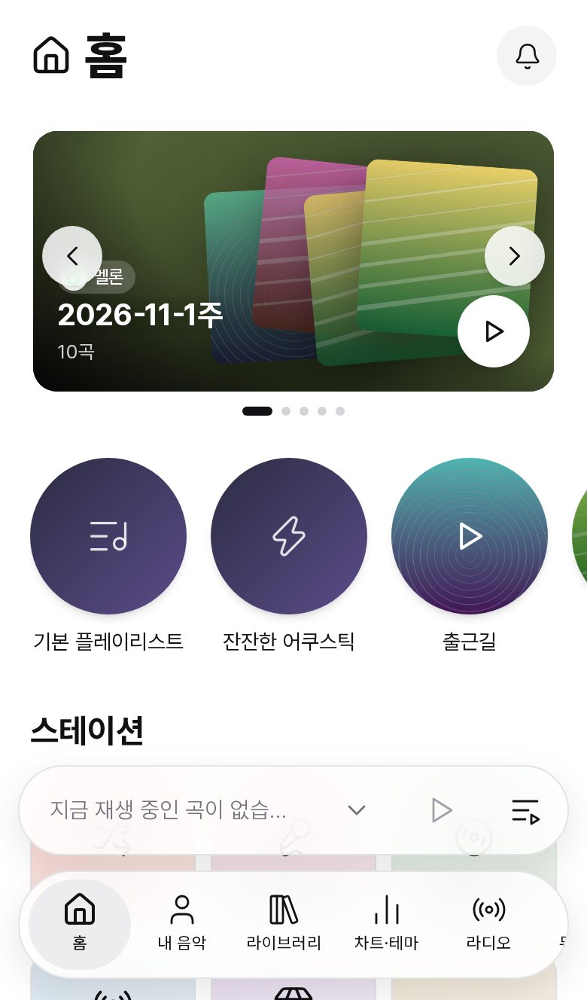
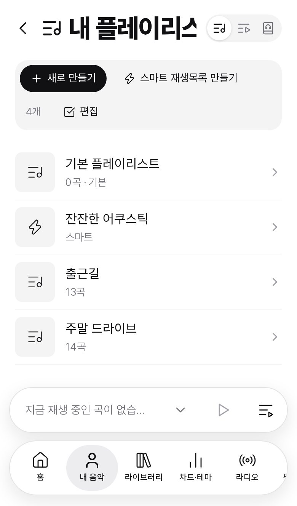
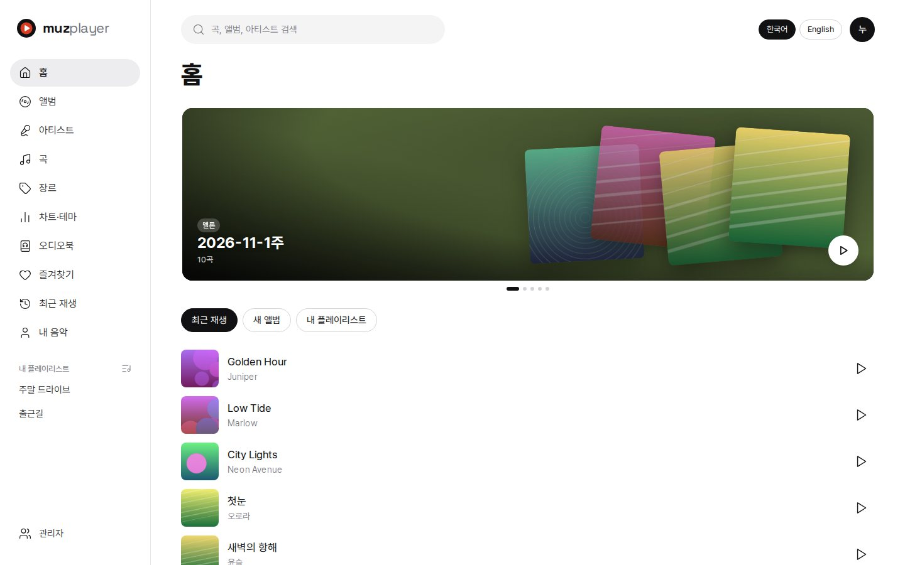
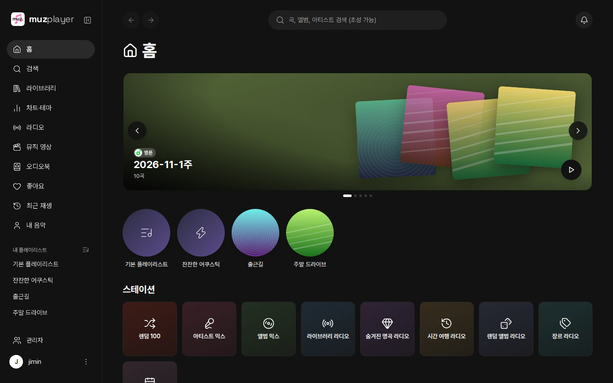

<p align="center">
  
</p>

<h1 align="center">muzplayer</h1>

<p align="center">
  NAS에 있는 음악·오디오북·뮤직 영상을 가족·지인이 각자 계정으로 듣는 셀프호스팅 웹 플레이어<br>
  Docker · 휴대폰 앱처럼 설치(PWA) · Windows 앱 · 한국어 / English
</p>

<p align="center">
  <a href="LICENSE"></a>
  <a href="https://hub.docker.com/r/zardkim/muzplayer"></a>
  <a href="https://hub.docker.com/r/zardkim/muzplayer"></a>
</p>

<p align="center">🇰🇷 한국어 | <a href="README.en.md">🇺🇸 English</a></p>

---

muzplayer는 NAS의 음악 폴더를 그대로 읽어 스트리밍 앱처럼 보여 줍니다. 파일을 옮기거나 바꾸지 않고, 음악 폴더는 읽기 전용으로만 씁니다.

## 주요 기능

- **라이브러리:** 앨범·아티스트·곡·커버곡·장르·폴더, 한글 초성 검색, 정규·비정규·컴필레이션·OST 자동 분류, Hi-Res·Lossless 표시
- **플레이어:** 싱크 가사(.lrc·태그, 없으면 알송·벅스·LRCLIB에서 자동으로), 관리자 가사 관리, 끊김 없는 재생, 크로스페이드, ReplayGain, 10밴드 EQ, 스트리밍 품질 선택, 오프라인 저장
- **나를 위한 음악:** 믹스, 스테이션·라디오(비슷한 곡 이어 듣기), 스마트 재생목록, 좋아요·별점, 플레이리스트 복사·이동
- **차트·테마:** 멜론·벅스 주차별 차트 폴더와 테마 모음을 배너와 추천 줄로(AI 배너 선택)
- **라디오:** 전국 라디오 방송을 실시간으로 중계, 주파수 다이얼 튜너
- **뮤직 영상:** YouTube·NAS 영상 등록과 재생, 영상에서 음원 추출(m4a/mp3, 태그·커버·가사 자동)
- **오디오북:** 챕터·속도·취침 타이머, 기기를 바꿔도 이어 듣기, Audiobookshelf에서 가져오기
- **여러 사용자:** 계정별 기록·좋아요·플레이리스트, 회원가입 승인, 관리자 화면(스캔·백업·복원·통계)
- **어디서나:** 휴대폰 홈 화면에 설치(PWA)·잠금 화면 조작, PC 브라우저, [Windows 앱](https://github.com/zardkim/muzplayer/wiki/Windows-앱)

자세한 설명은 [위키](https://github.com/zardkim/muzplayer/wiki)에 있습니다.

## 스크린샷

<table>
  <tr>
    <td align="center"><br>홈</td>
    <td align="center"><br>재생 화면</td>
    <td align="center"><br>차트·테마</td>
    <td align="center"><br>모던 다크 테마</td>
  </tr>
  <tr>
    <td align="center"><br>라디오</td>
    <td align="center"><br>오디오북</td>
    <td align="center"><br>내 플레이리스트</td>
    <td></td>
  </tr>
</table>


<details>
<summary>PC 화면 더 보기</summary>






</details>

> 스크린샷의 가수·곡·책 이름, 커버, 가사는 모두 데모용으로 만든 것입니다.

## 설치 (Docker Compose)

컨테이너는 `app`(muzplayer)과 `db`(PostgreSQL) 두 개입니다. 빌드는 필요 없고, 이미지는 Docker Hub의
[`zardkim/muzplayer`](https://hub.docker.com/r/zardkim/muzplayer)(amd64·arm64)를 받습니다.
아래 예시는 Synology NAS 경로(`/volume1/...`)를 쓰지만, 다른 Linux 서버도 경로만 바꾸면 똑같습니다.

### 1. 설치 폴더 만들기와 파일 받기

muzplayer의 모든 데이터가 들어갈 폴더를 하나 정합니다. 여기서는 `/volume1/docker/muzplayer`입니다.

```bash
mkdir -p /volume1/docker/muzplayer
cd /volume1/docker/muzplayer
curl -fsSLo docker-compose.yml https://raw.githubusercontent.com/zardkim/muzplayer/main/deploy/docker-compose.yml
curl -fsSLo .env.example      https://raw.githubusercontent.com/zardkim/muzplayer/main/deploy/.env.example
cp .env.example .env          # ← 설정 파일 이름은 반드시 .env (점으로 시작, 확장자 없음)
```

- Docker Compose는 `docker-compose.yml`과 **같은 폴더의 `.env` 파일**만 자동으로 읽습니다. `.env.example`을 그대로 두거나 `env.txt`처럼 다른 이름으로 바꾸면 설정이 적용되지 않습니다.
- `.env`처럼 점으로 시작하는 파일은 Synology File Station·Windows 탐색기에서 숨김 파일로 보일 수 있습니다. 숨김 파일 보기를 켜거나 SSH에서 `ls -a`로 확인하세요.
- `docker-compose.yml`은 고치지 않습니다. 바꿀 값은 모두 `.env`에 있습니다.

### 2. `.env` 설정

`.env`를 열어(`vi .env` 또는 File Station의 텍스트 편집기) 아래 값을 정합니다. **굵게 표시한 4개는 꼭** 바꿉니다.

| 항목 | 기본값 | 설명 |
|---|---|---|
| **`MUZPLAYER_DIR`** | `/volume1/docker/muzplayer` | 1단계에서 만든 설치 폴더의 **절대 경로**. 이 아래에 `app`·`db`·`conf`·`library`가 생깁니다. `./` 같은 상대 경로는 쓰지 않습니다(Portainer는 다른 폴더에서 실행하기 때문) |
| **`POSTGRES_PASSWORD`** | `change-me-…` | DB 비밀번호. 긴 임의 문자열(예: `openssl rand -hex 24`로 만든 값). **처음 실행한 뒤에는 바꾸지 않습니다**(바꾸면 DB에 접속하지 못함) |
| **`PUID`** / **`PGID`** | `1026` / `100` | 앱을 실행할 사용자 번호. 음악 폴더를 **읽을 수 있는** 사용자로 정합니다. SSH에서 `id <사용자이름>` → `uid=1026(…) gid=100(users)`라면 `PUID=1026`, `PGID=100` |
| **`HTTP_PORT`** | `18150` | 서버에서 열 포트. 브라우저는 `http://<서버 IP>:18150`, 역방향 프록시는 이 포트로 연결합니다 |
| `MUZPLAYER_IMAGE` | `zardkim/muzplayer` | 실행할 이미지. 직접 빌드한 이미지를 쓸 때만 바꿉니다 |
| `MUZPLAYER_VERSION` | `latest` | 이미지 태그. 특정 버전에 고정하려면 `0.69.2`처럼 적습니다 |
| `COOKIE_SECURE` | `true` | HTTPS(역방향 프록시) 뒤에서는 `true`. **`http://IP:포트`로 바로 접속해서 쓸 때는 `false`** — `true`면 http에서 로그인이 유지되지 않습니다 |
| `DEFAULT_LOCALE` | `ko` | 브라우저가 언어를 정하지 않았을 때의 화면 언어(`ko` / `en`) |
| `TZ` | `Asia/Seoul` | 시간대(재생 기록·통계의 날짜) |
| `SCAN_INTERVAL_MINUTES` | `60` | 음악 폴더를 자동으로 다시 스캔하는 주기(분). `0`이면 수동 스캔만 |
| `TRANSCODE_CACHE_MB` | `2048` | 변환한 곡(스트리밍 품질 낮춤, WMA·APE 등)을 `app/transcode`에 남겨 둘 크기 |
| `SESSION_DAYS` | `60` | 로그인 유지 기간(일) |
| `FORWARDED_ALLOW_IPS` | 사설 대역 | 방문자 주소(`X-Forwarded-For`)를 믿을 역방향 프록시의 주소. 기본값 `127.0.0.1,10.0.0.0/8,172.16.0.0/12,192.168.0.0/16`는 같은 서버나 집 안 네트워크의 프록시를 덮습니다. 프록시가 다른 공인 IP에 있을 때만 그 주소를 적습니다 |
| `FFMPEG_PATH` | (비움) | 보통 비워 둡니다. 이미지에 든 ffmpeg 대신 다른 것을 쓸 때만 |

관리자 계정, AI·YouTube API 키, 회원가입 방식은 `.env`가 아니라 **앱 안의 관리자 화면**에서 정합니다.

### 3. 폴더 구조와 음악 폴더 연결(마운트)

처음 실행하면 `MUZPLAYER_DIR` 아래에 다음 폴더가 자동으로 생깁니다.

```
/volume1/docker/muzplayer/          ← MUZPLAYER_DIR
├── docker-compose.yml
├── .env
├── app/            ← 커버 캐시, 변환 캐시, 관리자가 고른 가사(app/lrc) (자동 생성)
├── conf/           ← 앱에서 바꾼 설정·API 키 (자동 생성)
├── db/             ← 데이터베이스 (자동 생성)
└── library/        ← 앱에는 읽기 전용으로 연결됨
    ├── music/      ← 음악 폴더를 여기에 마운트            (필수)
    ├── audiobook/  ← 오디오북 폴더를 여기에 마운트        (선택, 비어 있으면 오디오북 메뉴가 숨겨짐)
    ├── video/      ← 뮤직 영상 파일 폴더를 여기에 마운트  (선택)
    └── cover music/← 뮤직 영상에서 추출한 음원 (앱이 직접 쓰는 유일한 폴더, 자동 생성)
```

음악이 이미 다른 곳(예: `/volume1/music`)에 있다면 **복사하지 말고** `library/music`에 **bind 마운트**로 연결합니다.
마운트할 빈 폴더를 먼저 만듭니다.

```bash
cd /volume1/docker/muzplayer
mkdir -p library/music library/audiobook library/video
```

> ⚠ **심볼릭 링크(`ln -s`)로는 안 됩니다.** 링크는 컨테이너 안에서 따라갈 수 없어 "음악 폴더를 찾지 못했습니다"가 됩니다. 반드시 마운트를 쓰세요.

**방법 A — 일반 Linux 서버 (`/etc/fstab`, 재부팅 후에도 유지)**

```bash
# /etc/fstab 에 추가 (원본 경로  →  연결할 경로)
/srv/music      /srv/muzplayer/library/music      none  bind,ro  0 0
/srv/audiobook  /srv/muzplayer/library/audiobook  none  bind,ro  0 0

sudo mount -a          # 바로 적용
```

**방법 B — Synology NAS (작업 스케줄러, 재부팅 후에도 유지)**

DSM은 `/etc/fstab`을 직접 관리해서 고친 내용이 업데이트 때 사라질 수 있으므로, 부팅할 때마다 마운트하는 작업을 등록합니다.

1. 제어판 → 작업 스케줄러 → 생성 → **트리거된 작업 → 사용자 정의 스크립트**
2. 사용자: **root**, 이벤트: **부트업**
3. 작업 설정의 스크립트에 아래 내용을 넣고 저장한 뒤, 목록에서 선택해 **실행**을 한 번 누릅니다.

```bash
D=/volume1/docker/muzplayer
mkdir -p $D/library/music $D/library/audiobook $D/library/video
grep -qs " $D/library/music " /proc/mounts     || mount --bind /volume1/music     $D/library/music
grep -qs " $D/library/audiobook " /proc/mounts || mount --bind /volume1/audiobook $D/library/audiobook
# 부팅 때 컨테이너가 마운트보다 먼저 떴을 수 있으므로 앱을 다시 시작
sleep 30 && docker restart muzplayer
```

**방법 C — 다른 NAS·PC의 공유 폴더 (NFS·SMB)**

같은 자리(`library/music`)에 직접 마운트하면 됩니다.

```bash
# NFS
sudo mount -t nfs  192.168.0.20:/volume1/music  /srv/muzplayer/library/music -o ro
# SMB(Windows 공유) — cifs-utils 필요
sudo mount -t cifs //192.168.0.20/music /srv/muzplayer/library/music -o ro,username=<사용자>,uid=<PUID>,gid=<PGID>
```

**확인과 권한**

```bash
ls /volume1/docker/muzplayer/library/music | head      # 음악 폴더 내용이 보여야 함
sudo -u '#<PUID>' ls /volume1/docker/muzplayer/library/music   # PUID 사용자로도 읽혀야 함
```

- 아무것도 안 보이면 마운트가 안 된 것입니다. 마운트 명령을 다시 확인하세요.
- `Permission denied`가 나오면 `PUID`/`PGID`를 음악 폴더를 읽을 수 있는 사용자로 바꾸거나, 그 사용자에게 읽기 권한을 줍니다(Synology: 공유 폴더 → 권한).
- 앱을 띄운 **뒤에** 마운트했다면 `docker restart muzplayer`로 앱만 다시 시작하면 보입니다.

### 4. 실행과 처음 설정

```bash
cd /volume1/docker/muzplayer
docker compose up -d
docker compose logs --tail 20 app      # "Uvicorn running" 이 보이면 준비 완료
```

1. 브라우저로 `http://<서버 IP>:18150`을 엽니다. **처음 만든 계정이 관리자**가 되므로, 외부에 열기 전에 먼저 만드세요.
2. 관리자 화면 → **라이브러리 폴더**에서 `library/music` 바로 아래 폴더마다 종류(앨범·컴필레이션·차트·테마·제외)를 고릅니다.
3. **스캔 시작**을 누릅니다. 첫 스캔은 곡 수에 따라 오래 걸릴 수 있습니다.
4. 관리자 화면 → **사용자**에서 가족·지인 계정을 만들거나, 회원가입 방식을 정합니다.
5. (선택) 관리자 화면 → **외부 서비스 키**에 YouTube 검색 키나 AI(Gemini·OpenAI) 키를 넣습니다.

- 휴대폰: Safari → 공유 → **홈 화면에 추가** / Chrome → **앱으로 설치**
- 밖에서 쓰려면 HTTPS 역방향 프록시(Synology 역방향 프록시, Nginx Proxy Manager 등)로 `http://<서버>:18150`에 연결하고 `COOKIE_SECURE=true`로 둡니다.
- **Portainer:** 스택 → 추가 → `docker-compose.yml` 내용을 붙여 넣고, `.env`의 각 줄을 **Environment variables**에 넣은 뒤 **Deploy the stack**. 폴더 만들기와 마운트(3단계)는 똑같이 먼저 해 둡니다.

## 업데이트

```bash
docker compose pull && docker compose up -d
```

DB 변경은 앱이 시작할 때 자동으로 적용됩니다. 버전별로 따로 할 일은 위키의 [업데이트](https://github.com/zardkim/muzplayer/wiki/업데이트)에 있습니다.

## 문서

| | |
|---|---|
| [설치](https://github.com/zardkim/muzplayer/wiki/설치) | 폴더 구조, `.env` 전체, Synology·Portainer, 처음 설정 |
| [라이브러리](https://github.com/zardkim/muzplayer/wiki/라이브러리) | 폴더 종류, 태그 규칙, 가사·아티스트 사진, 스캔 |
| [기능](https://github.com/zardkim/muzplayer/wiki/기능) | 전체 기능 설명 |
| [백업과 복구](https://github.com/zardkim/muzplayer/wiki/백업과-복구) | 앱 백업·복원, 명령으로 백업 |
| [개발](https://github.com/zardkim/muzplayer/wiki/개발) | 직접 빌드, 로컬 개발, 테스트 |

## 외부 서비스와 상표

- 앨범 정보·별점·아티스트 이름·가사는 벅스·멜론·알송·LRCLIB·MusicBrainz·Wikidata 등에서 가져오며, 일부는 **비공식 연동**입니다.
  서비스 쪽 변경으로 동작하지 않을 수 있고, 각 서비스 약관을 따릅니다. 개인적·비상업적 용도로 쓰세요.
- 방송사·차트 로고는 각 소유자의 상표이며 방송과 차트를 구분하는 용도로만 표시합니다. muzplayer는 이들과 관계가 없습니다.
- YouTube 음원 추출은 기본으로 꺼져 있습니다. 권리가 있거나 허락된 영상에만 사용하세요.

## 라이선스

muzplayer는 [GNU General Public License v3.0 or later](LICENSE)로 배포됩니다. Copyright (C) 2026 zardkim.

사용한 오픈소스와 각 라이선스(FFmpeg LGPL 빌드, mutagen GPL 등)는 [THIRD_PARTY_NOTICES.md](THIRD_PARTY_NOTICES.md)에 있습니다.
